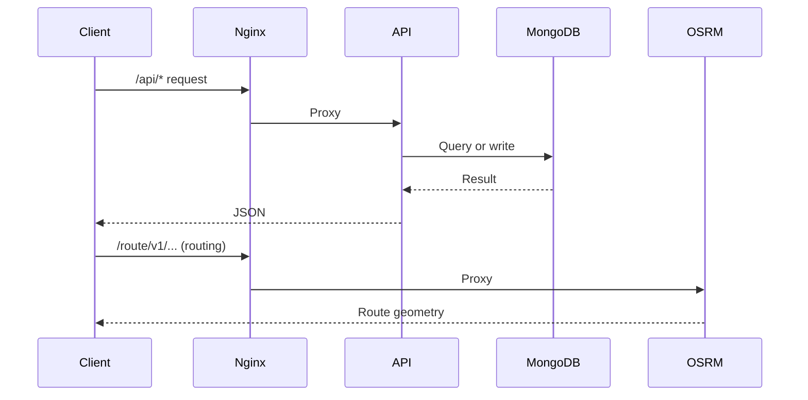
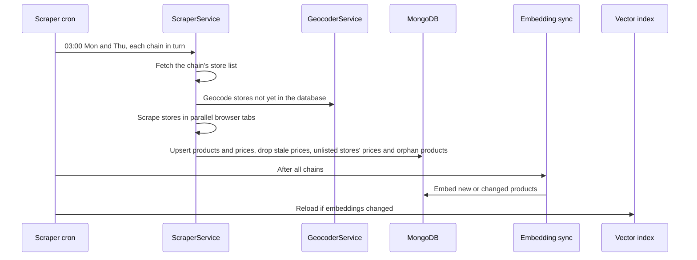
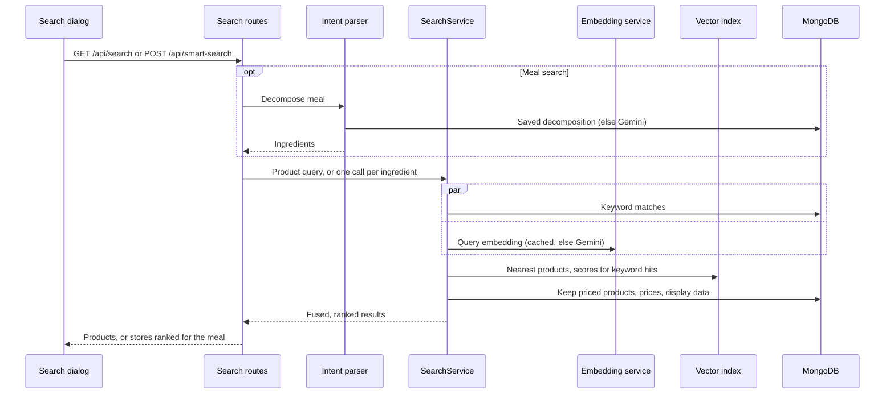

# Data And Request Flows

## Public Summary

Three flows carry the system: user requests (browser to API and to OSRM), price ingestion (scrapers into MongoDB, then embeddings), and search (product and meal). The containers they run on are in [System Architecture Overview](/architecture/overview).

## Internal Details

### User Request Flow

In production Nginx proxies both; in development the client calls the API and OSRM on their own ports. Requests from origins outside the CORS allow-list get a 403 before any route runs. Routing is detailed in [Routing & Map](/concepts/routing-and-map).

### Ingestion Flow

Chains are Vero, Ramstore, Stokomak and KAM, run one after another; stores within a chain are scraped 2 at a time in production and 4 in development (`SCRAPER_CONCURRENT_TABS`). `npm run scrape` runs the same scrape outside the cron; the vector index picks up its embeddings within 10 minutes. Details: [Scraper Module](/backend/modules/scraper), [Geolocation](/concepts/geolocation).

### Search Flows

Product search never calls the intent parser, and meal ingredients use only the vector step (keyword search is their fallback when the index isn't ready). The vector index lives in API memory, not in MongoDB. Rules, weights and thresholds: [Search Module](/backend/modules/search).

## Source Anchors

| Path | Relevance |
|------|-----------|
| `apps/nginx/nginx.conf` | Production proxying |
| `apps/server/src/config/corsOptions.js` | Origin allow-list |
| `apps/server/src/modules/scraper/scraper.cron.js` | Ingestion schedule, sync and index refresh |
| `apps/server/src/modules/scraper/scraper.service.js` | Per-chain scrape |
| `apps/server/src/modules/search/product-embedding-sync.service.js` | Embedding sync |
| `apps/server/src/modules/search/search.service.js` | Product search |
| `apps/server/src/modules/search/smart-search.service.js` | Meal search |
| `apps/client/src/features/map/components/GlobalAISearchDialog.jsx` | Search UI |
| `apps/client/src/features/map/pages/MapPage.jsx` | Map and routing UI |

## Risks and Trade-offs

- Scrapers depend on each chain's page structure; a site change breaks that chain until the scraper is fixed.
- New and changed products are found by keyword only until the embedding sync after the next scrape succeeds, which needs Gemini quota.
- A scrape run, embedding sync and index reload all happen in the API process while it serves traffic.
