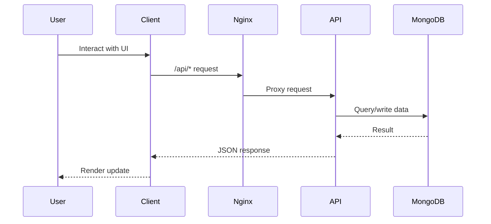
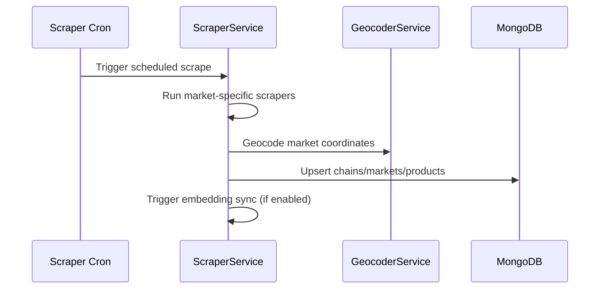

# Data And Request Flows

## Public Summary

The platform has three critical flows:

- User request flow (client to API and routing).
- Data ingestion flow (scrapers into MongoDB).
- Search enrichment flow (embeddings and smart search).

## Internal Details

### User Request Flow



### Scraper Ingestion Flow



### Search Flow

```mermaid
sequenceDiagram
  participant UI as Client Search UI
  participant API as Search/SmartSearch Routes
  participant SS as Search Services
  participant EMB as Embedding Service
  participant DB as MongoDB
  UI->>API: Search query
  API->>SS: Read query (rules; AI only to split meals) and execute strategy
  SS->>EMB: Generate query embedding
  EMB-->>SS: Query vector
  SS->>DB: Vector + keyword search
  DB-->>SS: Matched products
  SS-->>API: Ranked results (weighted fusion)
  API-->>UI: Search response
```

## Source Anchors

| Path | Relevance |
|------|-----------|
| `apps/server/src/modules/scraper/scraper.cron.js` | Cron trigger for ingestion flow |
| `apps/server/src/modules/scraper/scraper.service.js` | Scraper orchestration |
| `apps/server/src/modules/search/search.service.js` | Hybrid search (vector + keyword + fusion) |
| `apps/server/src/modules/search/smart-search.service.js` | Recipe and budget-aware search |
| `apps/client/src/features/map/pages/MapPage.jsx` | User-facing search and routing UI |

## Risks and Trade-offs

- Scraper reliability depends on external HTML structure stability.
- Embedding generation depends on third-party API availability and quota.
- Search quality and performance are coupled to embedding freshness.
