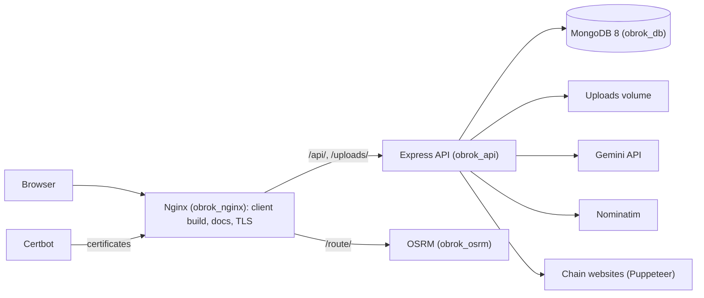
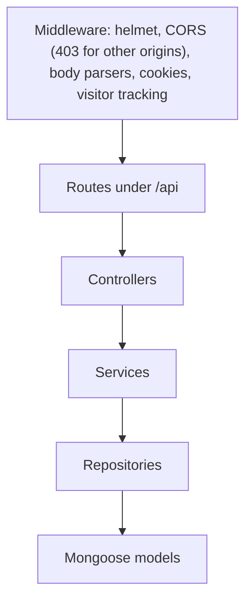
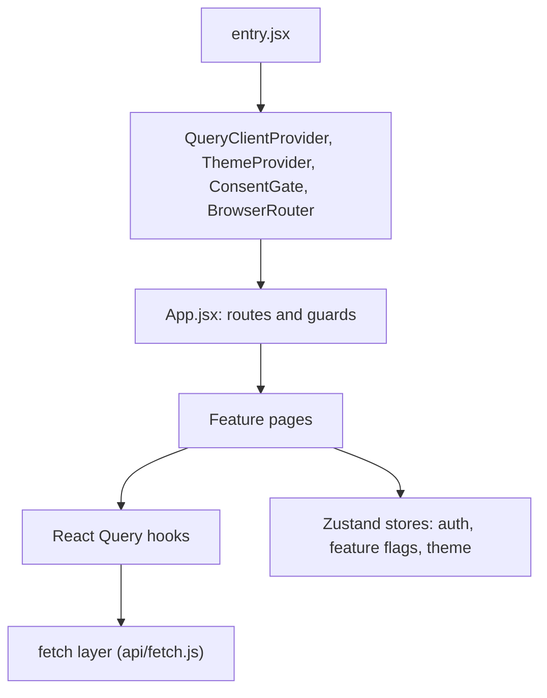

# System Architecture Overview

## Public Summary

Obrok runs as a few Docker containers: Nginx serves the React client and the docs and proxies to an Express API and to OSRM; the API stores everything in MongoDB, runs the scraper and analytics crons, and calls Gemini for search and Nominatim for geocoding. The main flows through this shape are in [Data And Request Flows](/architecture/flows).

## Internal Details

### Runtime Topology (production)

- The Nginx image is built from `apps/client`, so the client's static build is served by Nginx itself (SPA fallback to `index.html`). The docs build (`apps/docs/.vitepress/dist`) is mounted and served on `docs.obrok.net` with `$uri.html` routing; see [docs.obrok.net](/deployment/docs-obrok-net).
- Certbot renews certificates every 12 hours, and Nginx reloads every 12 hours to pick them up.
- The API process also runs the scraper cron (03:00 Skopje time, Monday and Thursday), the analytics cron and the in-memory vector index used by search.
- In development there is no Nginx: the client (Vite, port 3500), docs (5173), API (5000), OSRM (5001) and MongoDB run as separate containers, and the browser calls OSRM directly.

### Backend Layering

Routes add per-route middleware (auth, rate limits, zod validation). `container.js` wires every controller, service and repository; `server.js` connects to MongoDB, runs seeds and cleanup, starts the crons, listens, then prepares the vector index in the background.

### Frontend Layering

## Source Anchors

| Path | Relevance |
|------|-----------|
| `apps/server/src/app.js` | Middleware stack and route mounting |
| `apps/server/src/config/corsOptions.js` | Origin allow-list |
| `apps/server/src/server.js` | Startup, crons, vector index preparation |
| `apps/server/src/container.js` | Dependency wiring |
| `apps/client/src/entry.jsx` | Provider chain |
| `apps/client/src/components/layout/App.jsx` | Route tree and guards |
| `apps/client/src/store/` | Zustand stores |
| `docker-compose.dev.yml`, `docker-compose.prod.yml` | Service topology |
| `apps/nginx/nginx.conf` | Proxying, app and docs hosting |

## Risks and Trade-offs

- The API, both crons and the vector index (about 70 MB) share one process: simple to deploy, but a scrape run competes with web traffic for CPU and memory.
- Everything runs on one host: the routing graph (`data/map`) and certificates are bind mounts, the database a named volume (`obrok_db`).
- Search depends on one outside AI provider (Gemini) and new-store geocoding on the public Nominatim service; routing has no outside dependency.
