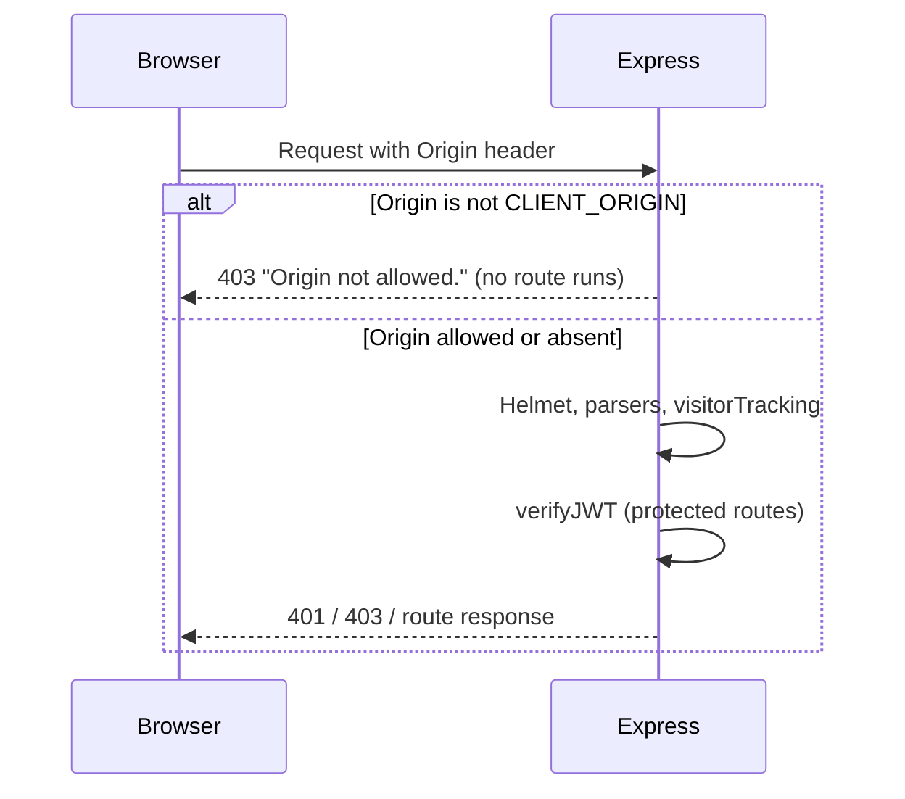

# Auth And Security

## Public Summary

Admins log in with a username and password and get a short-lived JWT access token plus a refresh token in an httpOnly cookie. Token details live in the [Auth Module](/backend/modules/auth). This page covers the controls around it: CORS, Helmet, authorization middleware, rate limits, uploads and error mapping.

## Internal Details

### Request Path

### CORS (`config/corsOptions.js`)

- Allowed: requests with no `Origin` header (same-origin, curl, scripts) and `Origin === CLIENT_ORIGIN`.
- Any other origin: the origin callback raises `AppError("Origin not allowed.", 403)`. The error handler answers 403 before any route runs, so a foreign page cannot trigger cookie-authenticated routes such as `/api/refresh` or `/api/logout`.
- `credentials: true`, preflight success status 200.
- CORS is not the access control. JWTs are.

### Authorization Middleware

| Middleware | Check | Failure | Used by |
|------------|-------|---------|---------|
| `verifyJWT` | `Authorization: Bearer <token>` signed with `ACCESS_TOKEN_SECRET` and carrying `UserInfo`. Sets `req.user` (username) and `req.role` | 401 | All protected routes |
| `verifyAdmin` | `req.role === "admin"` | 403 | Admin routes in chain, product, market, image, public-holiday, feature-flag, report, analytics |
| `verifyAdminUser` | `req.user === ADMIN_USERNAME` | 403 (500 if the env var is unset) | `GET /api/analytics/export` only |
| `optionalVerifyJWT` | Same as `verifyJWT`, but never rejects; sets only `req.user` | none | Search, smart search, analytics heartbeat |

### Rate Limits (per IP, `express-rate-limit`)

| Limiter | Limit | Route |
|---------|-------|-------|
| `loginLimiter` | 10 per 15 min | `POST /api/login` |
| `smartSearchLimiter` | 10 per min | `POST /api/smart-search` |
| `heartbeatLimiter` | 30 per min | `POST /api/analytics/heartbeat` |

Exceeding a limit returns 429 with a `{ message }` body.

### Other Controls

- **Helmet**: CSP only in production; `crossOriginResourcePolicy` is `cross-origin` so the client can load `/uploads` images.
- **Body size**: JSON and urlencoded bodies are capped at 1 MB.
- **Uploads** (`multerConfig.js`): JPEG, PNG and WebP only (checked by the client-sent MIME type), 10 MB max, stored in `src/uploads` with a random file name.
- **Visitor cookie**: `obrok_vid`, httpOnly, `sameSite=lax`, 90 days. See [Analytics](/backend/modules/analytics).

### Error Mapping (`errorHandler.js`)

| Error | Response |
|-------|----------|
| `ValidationError` (Zod) | 400 with a field-to-message object |
| `AppError` and subclasses (`NotFoundError`, `UnauthorizedError`) | its status, `{ message }` |
| `MulterError` | 400 (file too large gets a readable message) |
| Mongo duplicate key (`11000`) | 409 naming the field |
| Other 4xx (malformed JSON, payload too large) | that status, generic message unless the error is exposable |
| Anything else | 500 `Internal server error.`, logged |

## Source Anchors

| Path | Relevance |
|------|-----------|
| `apps/server/src/config/corsOptions.js` | Origin check and 403 |
| `apps/server/src/app.js` | Helmet, body limits, middleware order |
| `apps/server/src/modules/auth/middleware/` | `verifyJWT`, `verifyAdmin`, `verifyAdminUser`, `optionalVerifyJWT` |
| `apps/server/src/shared/middleware/rateLimiter.js` | Login and smart search limiters |
| `apps/server/src/modules/analytics/analytics.routes.js` | Heartbeat limiter |
| `apps/server/src/config/multerConfig.js` | Upload limits |
| `apps/server/src/shared/middleware/errorHandler.js` | Error mapping |

## Risks and Trade-offs

- Two admin checks exist: `verifyAdmin` (role claim) and `verifyAdminUser` (username equals `ADMIN_USERNAME`). Analytics export uses the stricter one; everything else accepts any user with role `admin`.
- Rate limits are in memory, so they reset on restart and assume a single API process.
- Upload type checking trusts the MIME type the client sends; file contents are not inspected.
- Requests without an `Origin` header pass CORS by design, so non-browser clients rely entirely on JWT checks.
