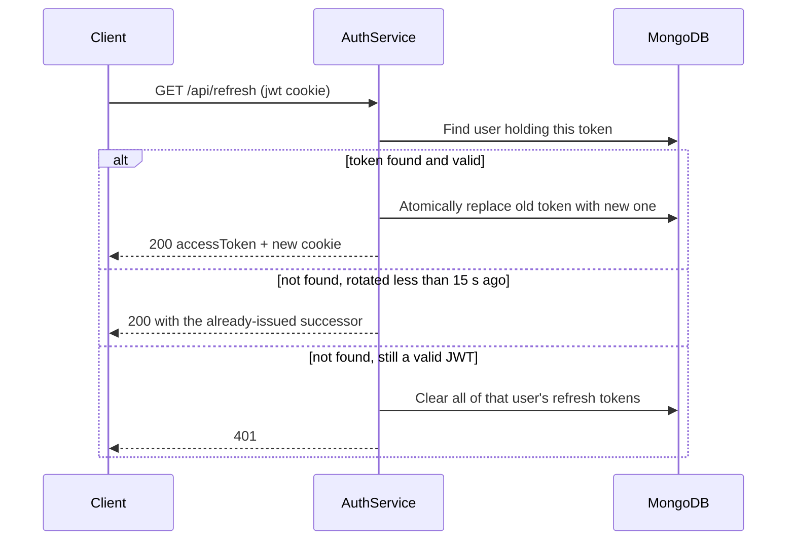

# Auth Module

## Public Summary

Username and password login for admins. The server returns a 15-minute JWT access token in the response body and a 1-day refresh token in an httpOnly cookie. Refresh tokens rotate on every use, and reusing an old one wipes the user's sessions. CORS, rate limits and the authorization middleware are covered in [Auth and Security](/backend/auth-security).

## Internal Details

### Files

| File | Role |
|------|------|
| `auth.routes.js` | Routes, login limiter, validation |
| `auth.controller.js` | Reads and sets the `jwt` cookie |
| `auth.service.js` | Login, logout, refresh rotation, reuse detection |
| `auth.repository.js` | User queries, atomic token rotation |
| `token.service.js` | JWT sign/verify, cookie options |
| `auth.schema.js` | `loginSchema` (username, password, both required) |
| `user.model.js` | `User` model |
| `middleware/` | `verifyJWT`, `verifyAdmin`, `verifyAdminUser`, `optionalVerifyJWT` |

The admin user is created at startup by `seedAdminUser` in `infrastructure/database/seed.js` from `ADMIN_USERNAME` and `ADMIN_PASSWORD` (bcrypt, 10 rounds, role `admin`), only if that username does not exist yet.

### Endpoints (mounted at `/api`)

| Method | Path | Auth | Response |
|--------|------|------|----------|
| `POST` | `/api/login` | Public, 10 attempts per 15 min per IP | 200 `{ accessToken }` and sets the `jwt` cookie |
| `GET` | `/api/logout` | `jwt` cookie (optional) | 204; clears the cookie and removes the token from the DB |
| `GET` | `/api/refresh` | `jwt` cookie | 200 `{ accessToken }` and a rotated `jwt` cookie |

### Tokens

| Token | Lifetime | Secret | Payload | Transport |
|-------|----------|--------|---------|-----------|
| Access | 15 min | `ACCESS_TOKEN_SECRET` | `{ UserInfo: { username, role } }` | JSON body, then `Authorization: Bearer` |
| Refresh | 1 day | `REFRESH_TOKEN_SECRET` | `{ username }` | Cookie `jwt`: httpOnly, secure, `sameSite=Lax`, maxAge 1 day |

### Data Model: User

```
username    : String (unique, required)
password    : String (bcrypt hash, required)
role        : "user" | "admin" (default "user")
refreshToken: [String]  one entry per logged-in device
```

### Refresh Flow



### Rules

- **Rotation**: `rotateRefreshToken` swaps the old token for the new one in one `findOneAndUpdate`, so two concurrent refreshes cannot both rotate the same token.
- **Grace window**: the service remembers each rotation in memory for 15 seconds. A second request with the same old token (two tabs, or a retry racing a refresh) gets the successor token instead of triggering reuse detection.
- **Reuse detection on refresh**: a cookie token that is a valid JWT but no longer in the DB (and outside the grace window) clears every refresh token of that user.
- **Reuse detection on login**: if the request carries a `jwt` cookie that is not in the DB, login drops all of the user's existing refresh tokens before adding the new one.
- **Expired or tampered token** that is still in the DB: it is removed and the request gets 401.

### Failure Modes

| Case | Response |
|------|----------|
| Missing username or password | 400 field errors |
| Unknown user or wrong password | 401 `{ message: "Unauthorized." }` |
| Login rate limit hit | 429 `{ message: "Too many login attempts..." }` |
| Refresh without cookie, expired, or reused | 401 |
| Missing or invalid `Bearer` token on a protected route | 401 (empty body) |
| Valid token without the admin role | 403 |

## Source Anchors

| Path | Relevance |
|------|-----------|
| `apps/server/src/modules/auth/auth.service.js` | Rotation, grace window, reuse detection |
| `apps/server/src/modules/auth/auth.repository.js` | Atomic rotation |
| `apps/server/src/modules/auth/token.service.js` | Lifetimes, secrets, cookie options |
| `apps/server/src/modules/auth/auth.routes.js` | Endpoints |
| `apps/server/src/modules/auth/user.model.js` | User schema |
| `apps/server/src/modules/auth/middleware/` | Request authorization |
| `apps/server/src/infrastructure/database/seed.js` | Admin user seed |

## Risks and Trade-offs

- The grace-window map is in memory. It is lost on restart and assumes a single API process.
- Refresh tokens are stored in plain text in `User.refreshToken` and the array is never pruned of expired entries except on use, logout or reuse.
- There is no user registration or password change endpoint. The admin password changes only through the database; changing `ADMIN_PASSWORD` does not update an existing user.
