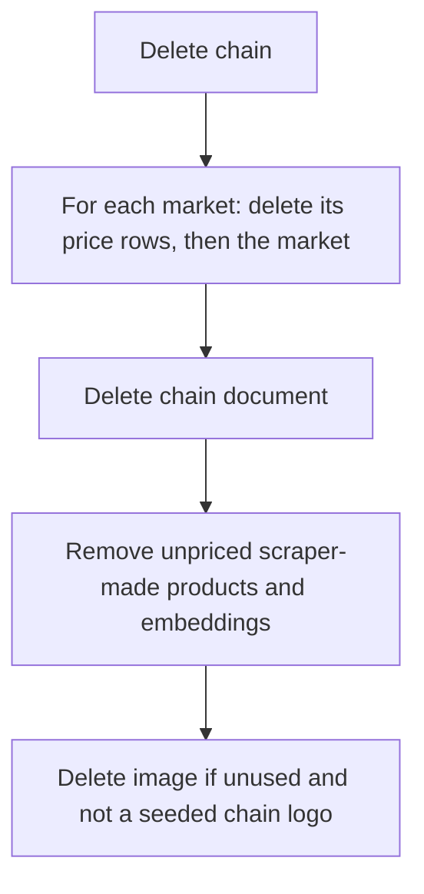

# Chain Module

## Public Summary

Manages supermarket chains (Vero, Ramstore, Stokomak, KAM and any an admin adds). Each chain has a logo image and owns its markets. Deleting a chain removes its markets, their prices and the products nobody else prices.

## Internal Details

### Endpoints

Mounted at `/api/chains`. "Admin" means `verifyJWT` + `verifyAdmin` (non-admins get 403). Update and delete take the `id` in the JSON body, not the URL.

| Method | Path | Auth | Description |
|--------|------|------|-------------|
| `GET` | `/chains` | Public | List chains with image and `markets`. Query: `page`, `limit`, `name` (case-insensitive substring) |
| `GET` | `/chains/:id` | Public | Chain detail with image and `markets` |
| `GET` | `/chains/report` | Admin | CSV download (`ChainsReport.csv`), one row per market: market, chain, location, chain image URL, products with prices |
| `POST` | `/chains` | Admin | Create. Body: `name`, `image` (both required; the image must exist) |
| `PUT` | `/chains` | Admin | Update. Body: `id`, optional `name`, `image` |
| `DELETE` | `/chains` | Admin | Delete with cascade. Body: `id` |

Ids in params and bodies are checked by the shared `idSchema` (`shared/schemas/zodObjectId.js`): a malformed id fails validation before the service runs.

### Pagination

The list uses `paginationWithAllSchema`: `limit` defaults to 10, is capped at 100, and `limit=0` returns every chain with `pagination: null` (the map and admin dropdowns load all chains this way).

### Data Model

```
name  : String (required, not unique)
image : ObjectId -> Image (required)
```

Virtual `markets`: markets whose `chain` points here. The scraper looks chains up by exact `name` and creates a missing one with its seeded `chain-<key>` logo.

### Cascade Delete

`ChainService.deleteChain`:

1. For each market of the chain: collect its product ids, delete all its MarketProduct rows (scraped and hand-added), delete the market.
2. Delete the chain.
3. Remove orphaned products: collected products with no price row left anywhere, and only if scraper-made (no description, no image). Their embeddings go with them. See [orphaned products](./scraper.md#orphaned-products).
4. Delete the chain's image if no chain or product uses it, unless it is a seeded `chain-<key>` logo (see [Image](./image.md#deletion-rules)).



## Source Anchors

| Path | Relevance |
|------|-----------|
| `apps/server/src/modules/chain/chain.routes.js` | Routes, auth and validation |
| `apps/server/src/modules/chain/chain.service.js` | CRUD, cascade delete, CSV report |
| `apps/server/src/modules/chain/chain.model.js` | Schema and `markets` virtual |
| `apps/server/src/shared/schemas/paginationSchema.js` | `paginationWithAllSchema` (`limit=0`) |
| `apps/server/src/shared/schemas/zodObjectId.js` | `idSchema` |
| `apps/server/src/modules/product/orphan-product.service.js` | Orphaned product removal |

## Risks and Trade-offs

- Chain names are not unique and the scraper matches by exact name. Renaming a scraped chain (e.g. "Vero") makes the next scrape create a second chain with that name.
- The cascade runs as separate writes without a transaction. A failure midway leaves some markets deleted and the chain still present; retrying the delete finishes it, and orphans it misses are caught by the startup sweep.
- The CSV report loads every market with all its prices in one query.
