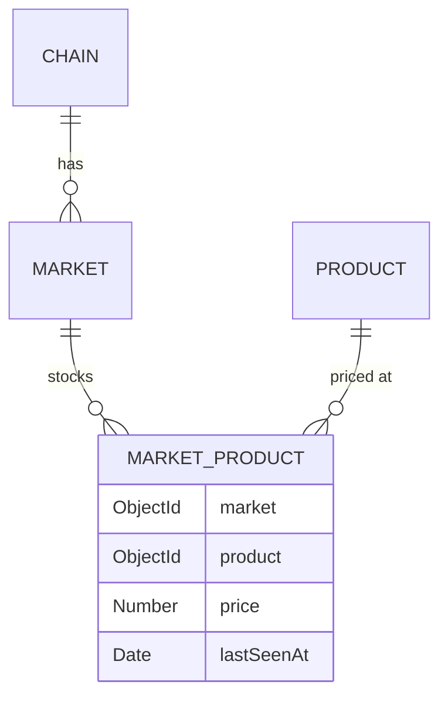

# Product Module

## Public Summary

The product catalog and its prices. A product has one row per market it is sold at (MarketProduct). The scraper owns most rows; admins can add and edit their own hand-added prices.

## Internal Details

### Files

| File | Role |
|------|------|
| `product.routes.js` / `product.controller.js` | Routes and HTTP handlers |
| `product.schema.js` | Zod schemas (query, create, update, categories) |
| `product.service.js` | CRUD and price-ownership checks |
| `product.model.js` / `product.repository.js` | Product schema and data access (incl. scraper upsert, orphan queries) |
| `market-product.model.js` / `market-product.repository.js` | Price rows (collection `market_products`) |
| `orphan-product.service.js` | Removes unpriced scraper-made products and their embeddings |

### Endpoints

Mounted at `/api/products`. "Admin" means `verifyJWT` + `verifyAdmin`. Update and delete take the `id` in the JSON body.

| Method | Path | Auth | Description |
|--------|------|------|-------------|
| `GET` | `/products` | Public | List. Query: `page`, `limit`, `title`, `category`, `marketId`, `minPrice`, `maxPrice` |
| `GET` | `/products/categories` | Public | Distinct non-null categories; with `marketId`, only that market's (sorted) |
| `GET` | `/products/:id` | Public | Product with image and every price row (market, chain, chain image) |
| `POST` | `/products` | Admin | Create. Body: `title` (required), optional `description`, `category`, `image`, and `market` + `price` together for a first hand-added price |
| `PUT` | `/products` | Admin | Update fields and hand-added prices (see below). `image: null` clears the image |
| `DELETE` | `/products` | Admin | Delete the product, all its price rows (scraped too), its embedding, and its image if unused |

`GET /products` has two shapes:

- Without `marketId`: Product documents with image and `marketProducts` (prices only). `minPrice`/`maxPrice` are ignored.
- With `marketId`: MarketProduct rows of that market with `product` (and its image) embedded, filtered by price range, title and category.

`title` and `category` filters are case-insensitive and bilingual (Cyrillic/Latin, `buildBilingualRegex`). Pagination uses `paginationSchema`: default `limit` 10, max 100, and `limit=0` is rejected, since each product carries all its prices. A duplicate `title` returns 409.

### Data Models

**Product**
```
title       : String (required, unique)
category    : String (optional; scrapers fall back to "Општо")
description : String (optional, admin-only)
image       : ObjectId -> Image (optional, admin-only)
```

**MarketProduct** (`market_products`)
```
market     : ObjectId -> Market (required)
product    : ObjectId -> Product (required)
price      : Number (required)
lastSeenAt : Date (null = hand-added; set by the scraper on every run that sees the row)
```

Indexes: unique `(market, product)` (one price per product per market), `(market, lastSeenAt)` for stale cleanup, `(product)` for search lookups.

### Price Ownership

A row with `lastSeenAt: null` was added by an admin; any other row belongs to the scraper, which overwrites its price and deletes it when the store stops listing the product (see [stale price cleanup](./scraper.md#stale-price-cleanup)). If the scraper later lists a hand-added product at that market, it stamps the row and takes it over.

`PUT /products` price fields:

| Field | Effect |
|-------|--------|
| `prices: [{ market, price }]` | Change hand-added prices |
| `removedMarkets: [marketId]` | Delete hand-added prices |
| `addedPrices: [{ market, price }]` | Add hand-added prices at markets the product has no row at |

All checks run before anything is saved, so a rejected request changes nothing:

- Any market in `prices` or `removedMarkets` without a hand-added row: 400 on `prices`.
- `addedPrices` with a repeated market, a market also in `prices`/`removedMarkets`, a market that doesn't exist, or a market that already has a row: 400 on `addedPrices`.

### Scraper-Made vs Admin-Edited

The scraper only writes `title` and `category`. A product with a `description` or `image` is treated as admin-edited: orphan cleanup never deletes it, and the legacy `lastSeenAt` backfill marks its rows as hand-added. See [orphaned products](./scraper.md#orphaned-products).



## Source Anchors

| Path | Relevance |
|------|-----------|
| `apps/server/src/modules/product/product.service.js` | CRUD, price-ownership validation |
| `apps/server/src/modules/product/product.schema.js` | Query and body schemas |
| `apps/server/src/modules/product/market-product.repository.js` | Market-scoped listing, manual price writes, scraper cleanup queries |
| `apps/server/src/modules/product/product.repository.js` | Scraper upsert, scraper-made filter |
| `apps/server/src/modules/product/orphan-product.service.js` | Orphan removal and startup sweep |

## Risks and Trade-offs

- Products are matched by exact `title` across all chains, so the same item spelled differently by two chains becomes two products.
- "Scraper-made" is inferred from missing `description` and `image`. An admin who edits only the title or category leaves the product deletable by orphan cleanup.
- The two `GET /products` response shapes differ; clients must know which one they asked for.
