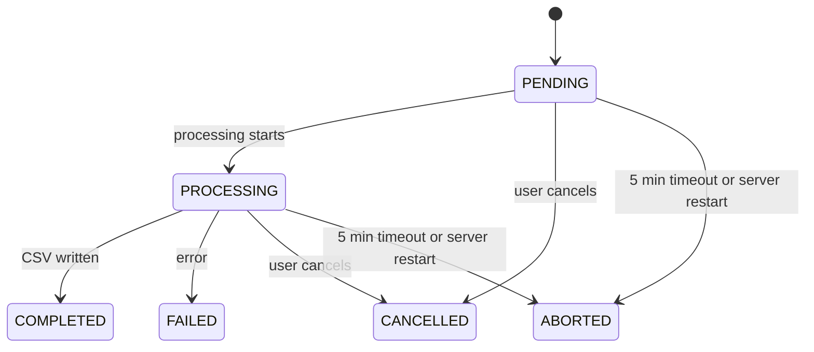

# Report Module

## Public Summary

Admins generate a CSV of markets and their product prices, filtered by date range and optionally by chain or market. Generation runs in the background as a job; the client polls its status and downloads the file once.

## Internal Details

### Files

| File | Role |
|------|------|
| `report.routes.js` | Routes, all behind `verifyJWT` and `verifyAdmin` |
| `report.controller.js` | Handlers; streams the download and deletes the file afterwards |
| `report.service.js` | Job lifecycle, timeout, CSV generation, stale file cleanup |
| `report.schema.js` | `createReportSchema`, `reportJobIdSchema` |
| `report-job.model.js` | `ReportJob` model (collection `report_jobs`) and `ReportJobStatus` |
| `report-job.repository.js` | Queries and conditional status transitions |

### Endpoints

All require a JWT with role `admin`. A job is visible only to the username that created it; another user's job returns 404.

| Method | Path | Success | Errors |
|--------|------|---------|--------|
| `POST` | `/api/reports` | 202 `{ jobId, status, filters }` | 400 invalid body, 409 user already has an active job |
| `GET` | `/api/reports/:jobId` | 200 `{ jobId, status, filters, error, createdAt, startedAt, finishedAt }` | 404 |
| `POST` | `/api/reports/:jobId/cancel` | 200 `{ jobId, status }` | 404, 409 job already finished |
| `GET` | `/api/reports/:jobId/download` | 200 `text/csv` attachment | 404 job or file missing, 409 not `COMPLETED` |

Create body: `from` and `to` (required dates, `from <= to`), `chainId` and `marketId` (optional ObjectIds).

### Job States



Every transition is a conditional `findOneAndUpdate` on the current status (`transition()`), so a cancel or timeout that lands mid-run is never overwritten by a later `COMPLETED` or `FAILED`. If the job was cancelled or timed out while the file was being written, the file is deleted.

### Generation

- Markets are selected by `chainId`, `marketId` and `lastScrapedUpdate` between `from` and the end of `to` (UTC).
- CSV columns: `market`, `chain`, `location`, `products` (one `title, price ден` line per product).
- The file is `report-<jobId>.csv` in `src/data/reports`. In production this directory is the `obrok_reports` Docker volume.

### File Cleanup

- A fully sent download deletes the file. An aborted download keeps it so the client can retry.
- `cleanupStaleReports` deletes `report-*.csv` files older than 24 hours. It runs at startup and after each new job is created.

### Data Model: ReportJob

```
requestedBy: String (username)
filters    : { chainId, marketId, from, to } (null when not given)
status     : PENDING | PROCESSING | COMPLETED | FAILED | CANCELLED | ABORTED
artifact   : String (file name, set on COMPLETED)
error      : String (failure, timeout or restart reason)
startedAt, finishedAt, createdAt, updatedAt: Date
```

## Source Anchors

| Path | Relevance |
|------|-----------|
| `apps/server/src/modules/report/` | Module files |
| `apps/server/src/modules/market/market.repository.js` | `findAllForReport` query |
| `apps/server/src/data/reports/` | CSV output directory |
| `apps/client/src/features/reports/hooks/useReportQueries.js` | Client polling (every 2 s while active) |

## Risks and Trade-offs

- Jobs run in the API process with in-memory cancel flags. A restart aborts them rather than resuming.
- One active job per user keeps load bounded, but there is no global limit across admins.
- The CSV loads every matching market with its products in memory before writing.
- `GET /api/chains/report` builds a similar CSV synchronously; it is a separate code path in the chain module.
