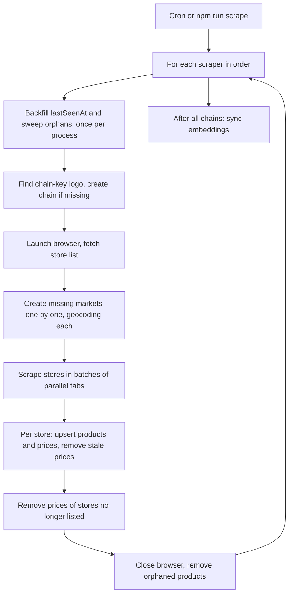

# Scraper Module

## Public Summary

Collects store locations and prices from four chains (Vero, Ramstore, Stokomak, KAM) twice a week. It creates missing chains and markets, geocodes new stores, upserts products and prices, removes prices stores no longer list, and then refreshes product embeddings for search.

## Internal Details

### Files

All under `apps/server/src/modules/scraper/`.

| File | Role |
|------|------|
| `scraper.service.js` | Orchestrator (`runForMarket`): browser, tabs, saving, cleanup |
| `scraper.cron.js` | Cron job |
| `scraper.registry.js` | Maps scraper keys to classes |
| `markets/base.scraper.js` | `BaseScraper` contract and shared helpers |
| `markets/{vero,ramstore,stokomak,kam}.scraper.js` | One scraper per chain |
| `geocoder.service.js`, `normalize-market-name.js` | Geocoding for new markets |
| `utils/table-evaluate.js` | Shared HTML table reader (runs in the browser) |
| `utils/parsePrice.js` | Price parsing |
| `utils/pdf-text-extractor.js` | Dependency-free PDF text extraction (KAM) |

### Registry and Contract

`scraper.registry.js` maps keys to classes: `vero`, `ramstore`, `stokomak`, `kam`. `createScraper(key)` returns a new instance or `null` (it uses `Object.hasOwn`, so inherited names like `constructor` are rejected); `createAllScrapers()` returns one of each in key order. `SCRAPER_KEYS` feeds the scripts' "Available:" messages.

Each scraper extends `BaseScraper` and implements:

| Member | Purpose |
|--------|---------|
| `chainName` | Chain document name (`Vero`, `Ramstore`, `Stokomak`, `KAM`) |
| `chainImageKey` | Seeded logo title `chain-<key>` |
| `geocodeSuffix` | Appended to geocode queries (default `Македонија`) |
| `fetchMarkets(page)` | Store list: `{ name, address, pricelistUrl }`, deduplicated by name |
| `fetchProducts(page, url, previousUpdate)` | `{ upToDate }` or `{ products, newUpdateDate, complete? }`; products are `{ title, price, category }` |

### Chains

| Key | Store list | Pricelist |
|-----|-----------|-----------|
| `vero` | Links `<store>_<page>.html` on `pricelist.vero.com.mk` | HTML table, follows numbered pages |
| `ramstore` | Store buttons on `ramstore.com.mk/marketi/` (`РАМСТОРЕ` normalized to `РАМСТОР`) | DataTables: reads all rows from the DataTable API; falls back to 100 rows per page and clicking "next" |
| `stokomak` | Store `<select>` on `stokomak.proverkanaceni.mk` (names prefixed `СТОКОМАК`) | HTML table, `perPage=100`, follows `»`/`следно` links |
| `kam` | JSON from `POST /ShopsWeb/LoadShopList` after loading `kam.com.mk/ceni-vo-marketi.nspx`; shops without a file are skipped, names prefixed `КАМ` | PDF per store, downloaded with Node `fetch` (60 s timeout, 3 attempts) |

Every scraper reads the pricelist's "last updated" date. If it equals the market's `lastScrapedUpdate`, it returns `upToDate` and the store is skipped. Rows marked unavailable (`Достапност` = `Не`) and prices that are not positive are dropped. A missing category becomes `Општо`.

### Run Flow

- Chains run one after another, each with its own browser. In the cron a failing chain is logged and the next one runs; `npm run scrape` stops at the first failing chain and exits 1.
- A chain run fails up front if its `chain-<key>` image is missing (see [Image](./image.md#deletion-rules)).
- A new store with no coordinates is skipped for this run (see Geocoding).
- A store fetch that hits a navigation timeout, `Runtime.callFunctionOn timed out` or `net::ERR_ABORTED` is retried once in a fresh tab. Any other error, or a crashed tab, skips only that store.
- Pages block images, stylesheets, fonts and media.

### Settings

| Setting | Default |
|---------|---------|
| Schedule | `0 3 * * 1,4`: Monday and Thursday 03:00 Europe/Skopje |
| `SCRAPER_CONCURRENT_TABS` | 2 in production, 4 otherwise |
| `SCRAPER_NAV_TIMEOUT_MS` | 90000 |
| `SCRAPER_PROTOCOL_TIMEOUT_MS` | 180000 |
| `SCRAPER_PAGINATION_WAIT_TIMEOUT_MS`, `SCRAPER_UPDATE_TEXT_WAIT_TIMEOUT_MS` | 15000, 12000 (Ramstore only) |
| `PUPPETEER_EXECUTABLE_PATH` | Puppeteer's bundled Chromium |

### Saving Prices

1. Products are deduplicated by title within the store: a title listed twice (repeated pages, duplicate rows) is saved once with the **last** price.
2. Products are upserted by exact `title`, setting `title` and `category` only. A duplicate-key race is retried up to 3 times.
3. Price rows are upserted by `(market, product)` and stamped with this run's `lastSeenAt`.
4. Stale price cleanup runs (below), then the market's `lastScrapedUpdate` is set to the pricelist date.

A store that returns 0 products is logged and left untouched.

### Stale Price Cleanup

After a store is saved, its scraper-owned rows not stamped by this run are deleted. This removes delisted and out-of-stock products.

- Hand-added rows (`lastSeenAt: null`) are never deleted by a scrape.
- Skipped with a warning when the scraper reports `complete: false`, or when the store now lists fewer than half as many products as its previous scrape. The baseline is the number of rows stamped by the previous scrape, so old stale rows can't block cleanup. A store's first stamped scrape has no baseline.
- `upToDate` stores are skipped entirely, so nothing is deleted.

### Stores Leaving the List

A store that drops out of the chain's store list is never scraped again. After all of the chain's stores are done, markets of that chain whose name is not in the fetched list lose their scraper-owned rows (hand-added rows stay), and the affected products become orphan candidates. The market itself is kept; delete it in the dashboard if the store closed.

Guard: if the fetched list has fewer than half of the chain's known markets, nothing is removed and a warning is logged, so a broken list page can't wipe the chain.

### Orphaned Products

A product whose last price row is gone is deleted with its embedding, but only if it is scraper-made (no `description`, no `image`). Admin-edited products are kept without prices. `OrphanProductService` re-checks every candidate for price rows right before deleting.

| Trigger | When |
|---------|------|
| Scrape (stale and unlisted-store cleanup) | Once the whole chain's run ends, since a product unpriced mid-run may get a price from another tab. Runs even if the chain run failed. |
| Chain or market delete | Right after the delete ([Chain](./chain.md#cascade-delete), [Market](./market.md#cascade-delete)) |
| `sweep()` | Once per process: at server startup, and before the first chain in `npm run scrape` |

### Legacy Backfill

Rows created before `lastSeenAt` existed (field missing) are backfilled once per process, at server startup or before the first chain in a script. Rows in markets with a `lastScrapedUpdate` are stamped as scraper-owned (epoch date, so they count as unseen) unless their product is admin-edited; all other legacy rows become hand-added (`null`).

### Geocoding

Only new markets are geocoded. Tiers, in order:

1. **Static file**: `src/data/market-coordinates.json`, keyed by `normalizeMarketName` (uppercase, collapsed spaces, `РАМСТОРЕ` to `РАМСТОР`).
2. **Nominatim** (`countrycodes=mk`): up to four queries from the cleaned address, the store name, a transliterated address, and the city. Requests are spaced at least 1.1 s apart. HTTP errors are logged; a 429 waits 5 s and retries once.
3. **City center**: if the address names one of 27 known cities, a point 80 to 249 m from its center, offset deterministically per store.

If all three fail, the market is skipped with a warning to add it to `market-coordinates.json`. Coordinates are `[lat, lon]`. See [Geolocation](/concepts/geolocation).

### Price Parsing

`utils/parsePrice.js` strips everything but digits, `.` and `,`, so currency text and spaces (including NBSP) are ignored.

- Both separators present: the last one is the decimal separator (`1.299,00`, `1,299.00`).
- One separator repeated, or once followed by exactly three digits (`2.450`): thousands, since MKD prices don't have three decimals.
- Otherwise it is the decimal separator.

Code inside `page.evaluate` (the table reader and Ramstore's DataTables path) can't import modules, so it returns raw `priceText` and Node parses it with `withParsedPrices`, which also drops non-positive prices.

### KAM PDF Text Extraction

`utils/pdf-text-extractor.js` inflates FlateDecode streams and maps glyph codes to Unicode through each font's ToUnicode CMap: `bfchar`, `bfrange` with a hex destination (the last UTF-16 code unit increments per code) and `bfrange` with an array destination. Destinations decode as UTF-16BE, so ligatures (`<00660069>` = "fi") and surrogate pairs work. Malformed entries, and ranges spanning 65536 codes or more, are skipped instead of failing the store.

### KAM Pricelist Rows

- Columns come from header labels (Назив производ, Продажна, Единична, Опис, Достапност), detected on the first page that has them. Title, price and availability are required.
- Names and descriptions wrap over several lines; only the first carries the price. A line with a price starts a product, and price-less lines up to 24 units below it are appended to its title and description (wrapped lines sit up to about 19 units down, the next product about 37). Header text above a page's first product and footers further down are ignored.
- KAM has no category column: the Опис text is stored as `category`.
- Availability is the first word of the Достапност column, because that column also picks up the promo price columns to its right.

### Embeddings

After all chains, `syncProductEmbeddings` embeds products whose `title + category` hash changed. It is skipped when the embedding service is unavailable or the `ai-search` flag is off. The cron then calls `vectorIndex.refreshIfStale()`; the standalone script does not. Details: [Search](./search.md).

### Scripts

Both scripts load the repo-root `.env` through `scripts/load-env.js`.

| Command | Effect |
|---------|--------|
| `npm run scrape` | All chains, then embedding sync |
| `npm run scrape -- <key>` | One chain; an unknown key exits 1 and lists the keys |
| `npm run scrape:db:wipe` | Empties `chains`, `markets`, `market_products`, `products`, `product_embeddings` (images stay) |
| `npm run scrape:db:wipe -- <key>` | Deletes the chain's markets and **all** their price rows (hand-added too), products left with no price (admin-edited too) and their embeddings, then the chain |

## Source Anchors

| Path | Relevance |
|------|-----------|
| `apps/server/src/modules/scraper/scraper.service.js` | Orchestration, saving, cleanup guards |
| `apps/server/src/modules/scraper/scraper.registry.js` | Key to class map |
| `apps/server/src/modules/scraper/scraper.cron.js` | Schedule, embedding sync, vector index refresh |
| `apps/server/src/modules/scraper/markets/` | `BaseScraper` and the four chain scrapers |
| `apps/server/src/modules/scraper/geocoder.service.js` | Geocoding tiers |
| `apps/server/src/modules/product/orphan-product.service.js` | Orphan removal and sweep |
| `apps/server/src/scripts/scrape.js` | Manual scrape |
| `apps/server/src/scripts/wipe-db-scrape-data.js` | Full and per-chain wipe |
| `apps/server/src/scripts/load-env.js` | `.env` loading for scripts |

## Risks and Trade-offs

| Failure | Behavior |
|---------|----------|
| Layout change breaks a parser | Store returns 0 products (left untouched) or far fewer (saved, stale cleanup skipped) |
| Store list page broken | Fewer than half the known stores: unlisted-store cleanup skipped |
| Transient navigation error | One retry, then the store is skipped |
| Tab crash | That store is skipped; others continue |
| Geocoding fails, city unknown | Market not created this run |
| Embedding provider down | Prices saved; embeddings catch up on the next sync |
| Chain run throws | Cron logs it and continues; the script exits 1 |

- No scraper currently returns `complete: false`; the incomplete-scrape guard exists for future scrapers that can detect failed pages.
- Markets and products are matched by exact name/title. Renaming either in the dashboard makes the next scrape create a duplicate.
- The half-of-previous guard trades freshness for safety: a store that genuinely halves its range keeps its stale prices for one more scrape. The skipped scrape becomes the baseline, so the next one cleans up.
- Scrapes depend on third-party sites; KAM depends on its PDF layout and fonts.
