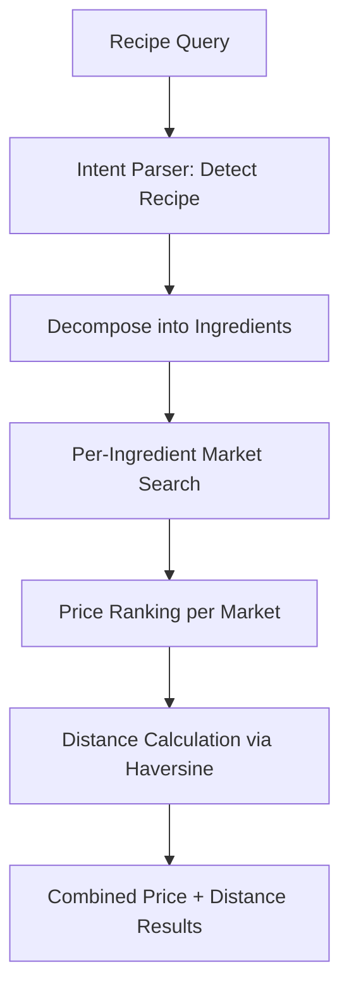

# Search Module

## Public Summary

Dual-mode AI-powered search: hybrid vector+keyword search for products and smart recipe-based search with geolocation and budget calculation.

## Internal Details

### Files

| File | Role |
|------|------|
| `search.controller.js` | Hybrid search HTTP handler |
| `search.service.js` | Hybrid search logic (vector + keyword + RRF) |
| `search.routes.js` | Search route definitions |
| `smart-search.controller.js` | Smart/recipe search HTTP handler |
| `smart-search.service.js` | Recipe decomposition + geolocation logic |
| `smart-search.routes.js` | Smart search route definitions |
| `embedding.service.js` | Gemini embedding generation |
| `product-embedding-sync.service.js` | Incremental embedding sync |
| `query-rules.js` | Rule-based price intent and query cleanup (no AI call) |
| `intent-parser.service.js` | Gemini meal decomposition (recipe search only) |
| `meal-intent.model.js` / `meal-intent.repository.js` | Saved meal decompositions |
| `product-embedding.model.js` | Embedding vector storage |
| `product-embedding.repository.js` | Embedding data access |

### Hybrid Search (SearchService)

**Endpoint**: `GET /search?q=...&marketId=...`

1. **Query rules** (`query-rules.js`): price words such as "najeftin", "најевтино" or "najskapo" set the price preference and are removed along with filler words. Latin queries are transliterated to Cyrillic for the embedding. No AI call is made.
2. **Parallel execution** of vector search (cosine similarity on embeddings) and keyword search (MongoDB text/regex).
3. **RRF merge** with k=60 to combine ranked results.
4. **Price sort**: when a price preference is present, all merged results are sorted by their best price before paging, so page 1 holds the cheapest (or most expensive) results.
5. **Market scoping** optimization when `marketId` is provided.

### Smart Search (SmartSearchService)

**Endpoints**:
- `POST /smart-search` — Recipe search with geolocation, body: `{ q, lat, lon, budgetOnly }`
- `GET /smart-search/budget` — Weekly budget calculation

### Embedding Service

- **Model**: Gemini text embeddings (768 dimensions); exact model id in `embedding.service.js` (`MODEL` constant).
- **Task-type-aware prompts**: the raw text is wrapped differently depending on whether it's being embedded as a document (`title: ... | text: ...`) or a query (`task: search result | query: ...`), matching Gemini's retrieval-tuning convention for asymmetric search.
- **Batch processing**: rate-limited at 350ms between batches.
- **Retry**: exponential backoff on rate-limit and transient network errors (timeouts, DNS failures, connection resets).

### Embedding Sync

- Uses a Mongoose cursor to stream products instead of bulk-loading all documents into memory.
- Loads only `product` and `textHash` fields from existing embeddings (skips 768-dim vectors) to build the diff map.
- Only products with changed or missing text hashes are sent for embedding generation.

### Intent Parser Service

- **Used by**: recipe search only. Product search never calls it.
- **Model**: Gemini Flash-Lite, with a second Flash-Lite model as fallback; exact model ids in `intent-parser.service.js` (`MODELS` constant).
- **Output**: `{ intent, products }` through a response schema. Ingredients are named the way Macedonian supermarkets label them. Price preference comes from the query rules, not the model.
- **Cache**: every decomposition is saved in the `meal_intents` collection, keyed so Latin and Cyrillic spellings of a meal share an entry, and kept for 180 days (TTL index). A 500-entry in-memory cache sits in front. Failed parses are not cached.

### Evaluation

`npm run eval:search` scores product search, meal ingredient picks and meal decomposition against the live catalogue, using the cases in `src/scripts/search-eval/cases.js`, and reports latency and AI call counts. Run it inside the API container (`docker exec obrok_api npm run eval:search`) before and after any search change. Flags: `--no-meals` skips the AI decomposition cases, `--no-meal-cache` bypasses saved meals, `--json=<file>` saves the results.

### Feature Flag Gates

| Flag | Controls |
|------|----------|
| `ai-search` | Enables hybrid vector+keyword search |
| `smart-search` | Enables recipe decomposition search |

When flags are disabled, search falls back to basic keyword-only behavior.

## Source Anchors

| Path | Relevance |
|------|-----------|
| `apps/server/src/modules/search/` | All search services, controllers, routes, models |

## Failure Modes

| Failure | Behavior |
|---------|----------|
| Gemini API unavailable | Graceful degradation to keyword-only search |
| Embedding generation fails | Products searchable via keyword only |
| Meal decomposition fails | Query is redirected to product search; the failure is not cached |
| Rate limit on embedding API | Exponential backoff retry |
