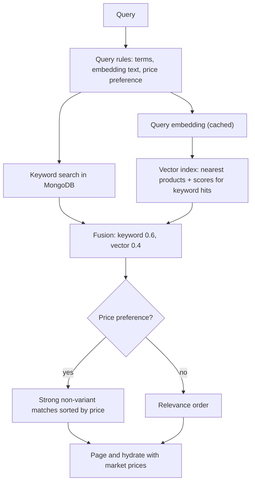
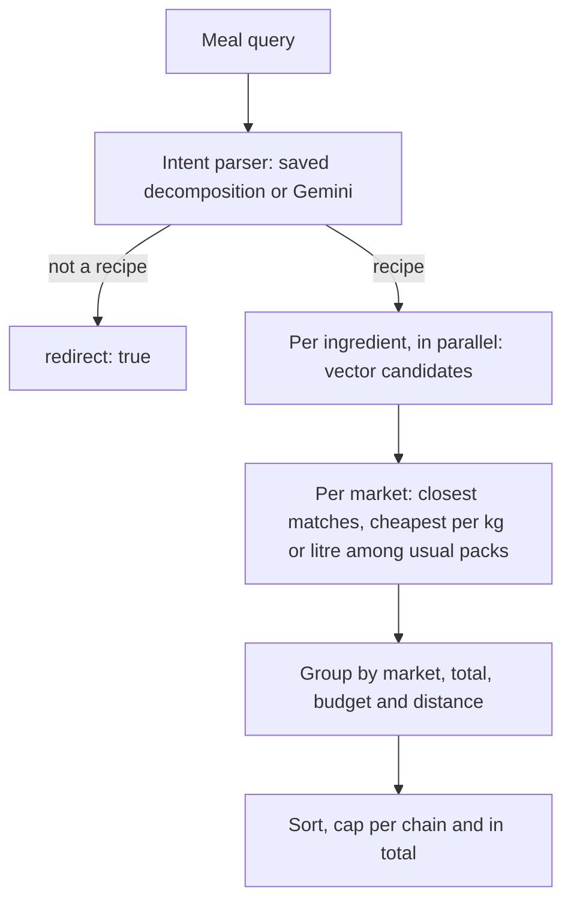

# Search Module

## Public Summary

Two search paths. Product search (`GET /api/search`) ranks products by fusing keyword matches with vector similarity from an in-memory index and never calls a language model. Meal search (`POST /api/smart-search`) asks Gemini to split a meal into ingredients, prices each ingredient per market and ranks markets against the weekly meal budget. This page is the precise reference; [Search & Recipe Decomposition](/concepts/search-and-recipes) explains the reasoning in plain language.

## Internal Details

### Files

In `apps/server/src/modules/search/`; `shared/...` paths are under `apps/server/src/`.

| File | Role |
|------|------|
| `search.routes.js`, `search.controller.js`, `search.schema.js` | `GET /api/search` |
| `search.service.js` | Product search orchestration (keyword + vector + fusion), ingredient candidates |
| `search.repository.js` | MongoDB queries: keyword matches, priced filter, price ranges, titles, display data |
| `hybrid-ranker.js` | Keyword scoring, weighted fusion, price sorting of strong matches |
| `query-rules.js` | Price words, filler words, transliteration, variant/accessory matcher, meal cache key |
| `smart-search.routes.js`, `smart-search.controller.js`, `smart-search.schema.js` | `POST /api/smart-search`, `GET /api/smart-search/budget` |
| `smart-search.service.js` | Meal search: ingredient picking, pack sizes, market ranking, budget |
| `intent-parser.service.js` | Gemini meal decomposition (meal search only) |
| `meal-intent.model.js`, `meal-intent.repository.js` | Saved meal decompositions (`meal_intents`) |
| `embedding.service.js` | Gemini embeddings, query cache, retries |
| `product-embedding-sync.service.js` | Incremental embedding sync |
| `product-embedding.model.js`, `product-embedding.repository.js` | Embedding storage (`product_embeddings`), packing migration, version check |
| `embedding-codec.js` | Packs embeddings as float32 bytes and reads them back |
| `vector-index.js` | In-memory int8 vector index |
| `shared/utils/packSize.js` | Reads pack sizes from titles |
| `shared/utils/obrokBudget.js`, `shared/utils/haversine.js` | Weekly budget, straight-line distance |
| `shared/ai/gemini-errors.js` | Transient-error detection and retry delays (shared by embeddings and intent parser) |

### Endpoints

| Endpoint | Middleware | Input |
|----------|------------|-------|
| `GET /api/search` | `optionalVerifyJWT`, query validation | `q` (1 to 200 chars), optional `marketId`, `page`, `limit` |
| `POST /api/smart-search` | `smartSearchLimiter` (10 requests per minute), `optionalVerifyJWT`, body validation | `q` (1 to 200 chars), optional `lat`, `lon`, `budgetOnly` (default false) |
| `GET /api/smart-search/budget` | none (no auth, no validation) | none |

Both search endpoints record feature usage (`hybrid-search`, `smart-search`) through the analytics service.

### Product Search (`SearchService.searchProducts`)

1. **Query rules** (`parseSearchQuery`): words matching the cheap stems (`евтин`, `ефтин`, `evtin`, `eftin`, optionally prefixed with `нај`/`naj`/`по`/`po`, plus `cheap*`, `budget`) set `priceSort: "asc"`; expensive stems (`скап`, `skap`, `expensive`, `luxury`, `premium`) set `"desc"`. These and filler words (`кој`, `каде`, `најди`, `барам`, `сакам`, `има`, `ли`, `ми`, `е` and Latin forms, plus a standalone `нај`/`naj` from "нај евтино" typed as two words) are removed. If nothing is left, the raw query is used. A query with no Cyrillic is transliterated to Cyrillic for the embedding only.
2. **Keyword search** (run in parallel with the query embedding): every query token must match title or category (bilingual regex). Titles starting with the query are fetched separately (up to 1500) so the general cap (500) can't crowd them out; products with no price are dropped. Each match is scored: 1 if the title starts with the query (allowing a 0 to 2 letter inflected ending), 0.8 if every query word starts a title word, 0.4 otherwise. Ties go to shorter titles. The top 100 are kept, or 500 when a price preference is present.
3. **Vector search**: the 300 nearest products across the whole catalogue, filtered to priced products, top 100. Every keyword match not among them is also scored against the index, so both signals exist for each candidate.
4. **Fusion** (`fuseResults`): vector scores are rescaled relative to the best hit; hits more than 0.1 below it are dropped. Score = 0.4 × relative vector score + 0.6 × keyword score. Results under 0.2 are cut.
5. **Price sort** (`sortStrongByPrice`): results with at least 80% of the best score that are not variants are sorted by price (lowest price across markets for "cheapest", highest for "most expensive"; unpriced last), before paging. Everything else follows in relevance order. Variants come from `buildVariantMatcher`:
   - titles containing `ЗА <query word>` for any query word of 3+ letters (egg dye "БОЈА ЗА ЈАЈЦА" for eggs, a bottle "ЗА МАСЛО" for oil), except a word that itself follows "за" in the query ("масло за готвење");
   - for milk queries: chocolate, cocoa, vanilla, strawberry, banana, hazelnut, shake and coffee creamer ("за кафе") titles, unless the query names that variant ("чоколадно млеко"). `^` is matched as Č because one chain writes it that way.

   Flavours are listed per product because they change what some products are (chocolate milk isn't milk) but not others (hazelnut chocolate is still chocolate). Embeddings don't separate these variants from the plain product reliably, so the rule is explicit.
6. **Hydration**: each result carries its product and market prices; with a price preference, a product's market offers are sorted by price too.

**Market scoping** (`marketId`): keyword search runs over that market's catalogue (up to 3000 matches, all scored), vector search is limited to that market's product ids, and price sorting uses that market's prices.

### Meal Search (`SmartSearchService.search`)

1. Returns `{ data: null, error }` if the `smart-search` flag is off or no `GEMINI_API_KEY` is set.
2. `parseIntent` returns `{ intent, products }`. If the intent isn't `recipe` or no ingredients come back, the response is `{ data: null, redirect: true, intent }`; the client then asks the user for a more concrete meal or to use the product search tab (it does not run product search itself).
3. Ingredients are priced in parallel (see below) while the weekly budget is computed.
4. Per market: matched ingredients, `totalPrice` (rounded), `complete`, `matchCount`, `withinBudget` (`totalPrice <= weeklyBudget`), `overBudgetAmount`, and per product an `overflow` flag once the running total passes the budget. `distance` is haversine metres from `lat`/`lon` when both are given.
5. **Sort**: complete first, then within budget, then more matched ingredients, then nearer (when both distances are known), then cheaper. `budgetOnly` drops markets over budget.
6. At most 3 markets per chain (stores of one chain usually share a pricelist) and 20 in total. `nearestMarket` is the first complete market with a distance. The response also carries `shoppingList` (name, found), `priceSort` (default `"asc"`), `weeklyBudget` and `budgetInfo`.

### Ingredient Selection (`findIngredient`)

1. **Candidates** (`SearchService.findIngredientCandidates`): the 300 nearest priced products to the ingredient's embedding, kept only within 0.025 of the best score. Keyword matches alone never qualify: misleading word matches ("ПАСТА ЗА ЗАБИ" for "паста", a sauce "СО СИРЕЊЕ" for "сирење") sit 0.03 or more below the best match.
2. **Per market**: among the candidates that market sells, only those within 0.01 of its own best one compete, so a cheaper near-miss (instant noodles for pasta, a vegan spread for cheese) can't win on price.
3. **Pack size** (`usualPackSize`, `cheapestSensiblePack`): `parsePackSize` reads the quantity from the title ("500ГР", "0,75Л", "1 ЛИТ", "250ML", multipacks like "6Х0.5Л"; the last size in the title wins; a bare "КГ" means a price per kilogram). The usual pack is the median size across all candidates in their most common unit (grams if at least half the packs are in grams). Within a store, the cheapest per kilogram or litre wins among packs between half and double the usual size; a price per kilogram counts as a 1 kg pack. This keeps 10×10 g creamer portions from pricing milk and a 1 kg block from pricing a 400 g cheese.
   - No usual size (fewer than three packaged sizes among candidates, or under a third of candidates with any size, as with eggs or loose cheese): cheapest package price.
   - No competing product in the size range: cheapest product without a readable size, else cheapest overall.
   - The basket always adds the package price, not the per-unit price.
4. **Fallback** (vector index not ready): product search (`searchProducts`, top 20) is filtered to titles that name the ingredient as a word (`pickIngredientCandidates`) and the cheapest per market wins. If none name it, the top 3 results are used and each market keeps its best-ranked one, not the cheapest.

### Weekly Budget

`calculateWeeklyBudget` in `shared/utils/obrokBudget.js`: 140 MKD for each Monday to Saturday of the current week (Skopje calendar), minus public holidays from the public-holiday module. When the week spans two months, `budgetInfo.segments` splits the days and budget per month.

### Intent Parser

- **Models**: `MODELS` in `intent-parser.service.js` (`gemini-3.5-flash-lite`, falling back to `gemini-3.1-flash-lite` when a model id is unavailable; the model that last worked is tried first). JSON response schema, temperature 0.
- **Output**: `{ intent: "recipe" | "search", products }`, deduplicated, at most 10 ingredients, named the way Macedonian supermarkets label them (the prompt skips water, salt and pepper). Price preference comes from the query rules, not the model.
- **Cache**: 500-entry in-memory map in front of the `meal_intents` collection, keyed by `mealCacheKey` so Latin and Cyrillic spellings share an entry; documents expire after 180 days (TTL on `createdAt`). Failed parses are not cached.
- **Retries**: 3 per model on transient errors.

### Embedding Service

- **Model**: `gemini-embedding-2` at 768 dimensions (`MODEL`, `DIMENSIONS`).
- **Formats**: queries are always embedded as `task: search result | query: <text>` (`generateEmbedding`); product texts as `title: <text> | text: <text>` (`generateBatchEmbeddings`). There is no `taskType` parameter.
- **Query cache**: 2000 entries, least recently used evicted, keyed by the trimmed lower-case text. Repeated searches and common meal ingredients don't call the API again.
- **Batches**: 20 texts embedded in parallel, then a 350 ms pause.
- **Retries**: up to 8 on transient errors (HTTP 429/5xx, `RESOURCE_EXHAUSTED`, `UNAVAILABLE`, network errors such as timeouts, DNS failures and connection resets). The delay is the server's "retry in Ns" hint or exponential backoff from 2 s with jitter, capped at 60 s (30 s in the intent parser).

### Embedding Sync

`syncProductEmbeddings` runs after every scheduled scrape and from `npm run embeddings:generate` (`:force` re-embeds everything). It skips when no API key is set or `ai-search` is off.

- The embedded text is the product title plus its category; its MD5 hash is compared with the stored `textHash`, so only new or changed products are embedded.
- Products are streamed with a cursor; only `product` and `textHash` of existing embeddings are loaded.
- Products go to the embedding service 50 at a time and are upserted after each batch.

### Embedding Storage

Embeddings are stored as packed little-endian float32 bytes (3 KB each) instead of BSON number arrays (about 10 KB each). Old arrays are converted by an idempotent migration at startup (`packLegacyEmbeddings`), which leaves `updatedAt` alone so the index doesn't see a change. On the dev catalogue this took the collection from 933 MB to 300 MB; run `db.runCommand({ compact: "product_embeddings" })` once afterwards to return the freed disk space.

### Vector Index

- **What**: every embedding held in memory as a normalized int8 vector with a per-row scale, scored by brute force. About 70 MB for 93k products at 768 dims; a full scan takes tens of milliseconds, so no vector database is needed. Search can be limited to a set of product ids (one market's catalogue).
- **Why not query Mongo**: vector search used to regex-filter products by the query words and score only those, so it could never find a product that shares no word with the query ("паста" could not find ФУСИЛИ). The index scores everything.
- **Startup** (`prepareVectorIndex` in `server.js`, after the server starts listening): auto-refresh starts first, so it runs even if the startup load fails; then the packing migration; then a load if `ai-search` is on. Until the index is ready, search is keyword-only.
- **Lazy load**: if the index isn't ready when a search needs a query vector, that search starts a background load and runs keyword-only.
- **Freshness**: `refreshIfStale` reloads when the version (embedding count plus newest `updatedAt`) changed. It runs after the scraper cron's embedding sync and every 10 minutes, which covers `npm run scrape` and `npm run embeddings:generate` running in their own process.
- **Unpriced products**: catalogue-wide hits are filtered to products that still have a price, so delisted products in a not-yet-refreshed index never show up.

### Feature Flags

| Flag | Off means |
|------|-----------|
| `ai-search` | `GET /api/search` returns an empty result; embedding sync and the startup index load are skipped |
| `smart-search` | `POST /api/smart-search` returns `{ data: null, error }` |

### Evaluation

`npm run eval:search` scores product search, meal ingredient picks and meal decomposition against the live catalogue using `src/scripts/search-eval/cases.js`, and reports latency and AI call counts. Ingredient rows show the usual pack size and the share of picked titles with a readable size. Run it in the API container (`docker exec obrok_api npm run eval:search`) before and after any search change. Options: a bare word runs only cases containing it, `--no-meals` skips the decomposition cases, `--no-meal-cache` bypasses saved meals, `--json=<file>` saves the results.

## Source Anchors

| Path | Relevance |
|------|-----------|
| `apps/server/src/modules/search/` | Services, controllers, routes, models |
| `apps/server/src/modules/search/hybrid-ranker.js` | Fusion weights and thresholds |
| `apps/server/src/modules/search/query-rules.js` | Price and filler words, variant matcher |
| `apps/server/src/modules/search/smart-search.service.js` | Ingredient picking, pack sizes, market ranking |
| `apps/server/src/shared/utils/packSize.js` | Pack size parsing |
| `apps/server/src/shared/utils/obrokBudget.js` | Weekly budget |
| `apps/server/src/shared/ai/gemini-errors.js` | Retry rules |
| `apps/server/src/server.js` | Vector index startup |
| `apps/server/src/modules/scraper/scraper.cron.js` | Sync and refresh after scraping |
| `apps/server/src/scripts/eval-search.js` | Evaluation script |

## Risks and Trade-offs

| Situation | Behavior |
|-----------|----------|
| No `GEMINI_API_KEY` | Product search is keyword-only; meal search returns "AI service is not configured." |
| Embedding API errors during a search | Transient errors are retried up to 8 times (waits up to 60 s each), then the request fails; there is no keyword-only fallback for a failing API |
| Meal decomposition fails (after retries on both models) | `redirect: true`; the failure is not cached |
| Vector index not loaded yet | Keyword-only results until the load finishes |
| Embedding sync fails | New or changed products are found by keyword only until the next sync |

- The fusion weights, vector window, strong-match share and ingredient bands are tuned against the small hand-written cases in `npm run eval:search`, not a labeled relevance dataset.
- Variant rules are a hand-kept list (milk flavours only so far); other products' variants still compete on price.
- The index lives in the API process: about 70 MB of memory, reloaded in full on every change.
