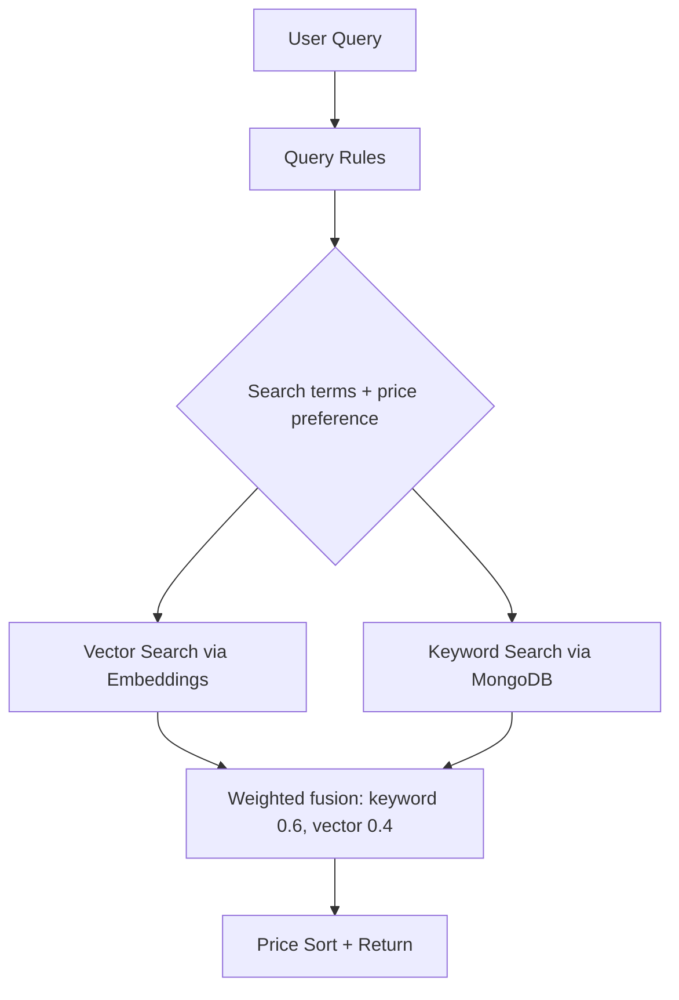
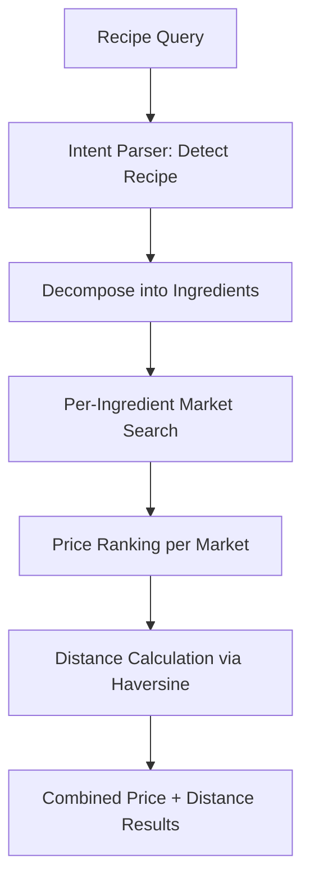

# Search Module

## Public Summary

Dual-mode AI-powered search: hybrid vector+keyword search for products and smart recipe-based search with geolocation and budget calculation.

## Internal Details

### Files

| File | Role |
|------|------|
| `search.controller.js` | Hybrid search HTTP handler |
| `search.service.js` | Hybrid search orchestration (vector + keyword + fusion) |
| `hybrid-ranker.js` | Keyword relevance scores, weighted fusion, price sorting of strong matches |
| `search.routes.js` | Search route definitions |
| `smart-search.controller.js` | Smart/recipe search HTTP handler |
| `smart-search.service.js` | Recipe decomposition + geolocation logic |
| `smart-search.routes.js` | Smart search route definitions |
| `embedding.service.js` | Gemini embedding generation |
| `product-embedding-sync.service.js` | Incremental embedding sync |
| `query-rules.js` | Rule-based price intent and query cleanup (no AI call) |
| `intent-parser.service.js` | Gemini meal decomposition (recipe search only) |
| `meal-intent.model.js` / `meal-intent.repository.js` | Saved meal decompositions |
| `product-embedding.model.js` | Embedding vector storage |
| `product-embedding.repository.js` | Embedding data access, including the one-time packing migration |
| `embedding-codec.js` | Packs embeddings as float32 bytes and reads them back |
| `vector-index.js` | In-memory vector index used by vector search |

### Hybrid Search (SearchService)

**Endpoint**: `GET /search?q=...&marketId=...`

1. **Query rules** (`query-rules.js`): price words such as "najeftin", "најевтино" or "najskapo" set the price preference and are removed along with filler words. Latin queries are transliterated to Cyrillic for the embedding. No AI call is made.
2. **Parallel execution** of vector search (nearest neighbours in the in-memory index, over the whole catalogue) and keyword search (MongoDB regex).
3. **Fusion** (`hybrid-ranker.js`): each keyword match gets a relevance score (1 if the title starts with the query, 0.8 if every query word starts a title word, 0.4 otherwise), fetched as two queries so titles starting with the query are never crowded out by the candidate cap. Every candidate also gets a vector score from the index. Scores are combined with weights 0.6 and 0.4; vector hits more than 0.1 below the best are dropped, and results under 0.2 are cut.
4. **Price sort**: when a price preference is present, strong matches (at least 80% of the best score) are sorted by price across all results before paging; weaker matches follow in relevance order.
5. **Market scoping** optimization when `marketId` is provided.

### Smart Search (SmartSearchService)

**Endpoints**:
- `POST /smart-search` — Recipe search with geolocation, body: `{ q, lat, lon, budgetOnly }`
- `GET /smart-search/budget` — Weekly budget calculation

### Embedding Service

- **Model**: Gemini text embeddings (768 dimensions); exact model id in `embedding.service.js` (`MODEL` constant).
- **Task-type-aware prompts**: the raw text is wrapped differently depending on whether it's being embedded as a document (`title: ... | text: ...`) or a query (`task: search result | query: ...`), matching Gemini's retrieval-tuning convention for asymmetric search.
- **Batch processing**: rate-limited at 350ms between batches.
- **Retry**: exponential backoff on rate-limit and transient network errors (timeouts, DNS failures, connection resets).

### Vector Index

- **What**: every product embedding held in memory as an int8 vector with a per-row scale, about 70 MB for 93k products at 768 dims. A brute-force scan of the whole catalogue takes about 50 ms, and a single market's catalogue about 20 ms; top results match exact float scoring on 95 to 98% of the top 100.
- **Why not query Mongo**: vector search used to regex-filter products by the query words and score only those, so it could never find a product that doesn't share a word with the query ("паста" could not find ФУСИЛИ). The index scores everything.
- **Loading**: at startup, after the packing migration, when `ai-search` is on (about 2 s, in the background; search is keyword-only until it's ready). If `ai-search` is switched on later, the first search starts the load.
- **Freshness**: reloaded after the scraper cron's embedding sync, and every 10 minutes if the newest embedding changed (covers `npm run scrape` and `npm run embeddings:generate`, which run in their own process).
- **Unpriced products**: hits are filtered to products that still have a price, so deleted or delisted products in a not-yet-refreshed index never show up.

### Embedding Storage

Embeddings are stored as packed little-endian float32 bytes (3 KB each) instead of BSON number arrays (about 10 KB each). On the dev catalogue this took the collection from 933 MB to 300 MB. Existing arrays are converted by an idempotent migration at startup (`packLegacyEmbeddings`); run `db.runCommand({ compact: "product_embeddings" })` once afterwards to return the freed disk space.

### Query Embedding Cache

Query embeddings are cached in memory (2000 entries, least recently used evicted), so repeated searches and common meal ingredients don't call the embedding API again.

### Embedding Sync

- Uses a Mongoose cursor to stream products instead of bulk-loading all documents into memory.
- Loads only `product` and `textHash` fields from existing embeddings (skips 768-dim vectors) to build the diff map.
- Only products with changed or missing text hashes are sent for embedding generation.

### Intent Parser Service

- **Used by**: recipe search only. Product search never calls it.
- **Model**: Gemini Flash-Lite, with a second Flash-Lite model as fallback; exact model ids in `intent-parser.service.js` (`MODELS` constant).
- **Output**: `{ intent, products }` through a response schema. Ingredients are named the way Macedonian supermarkets label them. Price preference comes from the query rules, not the model.
- **Cache**: every decomposition is saved in the `meal_intents` collection, keyed so Latin and Cyrillic spellings of a meal share an entry, and kept for 180 days (TTL index). A 500-entry in-memory cache sits in front. Failed parses are not cached.

### Evaluation

`npm run eval:search` scores product search, meal ingredient picks and meal decomposition against the live catalogue, using the cases in `src/scripts/search-eval/cases.js`, and reports latency and AI call counts. Run it inside the API container (`docker exec obrok_api npm run eval:search`) before and after any search change. Flags: `--no-meals` skips the AI decomposition cases, `--no-meal-cache` bypasses saved meals, `--json=<file>` saves the results.

### Feature Flag Gates

| Flag | Controls |
|------|----------|
| `ai-search` | Enables hybrid vector+keyword search |
| `smart-search` | Enables recipe decomposition search |

When flags are disabled, search falls back to basic keyword-only behavior.

## Source Anchors

| Path | Relevance |
|------|-----------|
| `apps/server/src/modules/search/` | All search services, controllers, routes, models |

## Failure Modes

| Failure | Behavior |
|---------|----------|
| Gemini API unavailable | Graceful degradation to keyword-only search |
| Embedding generation fails | Products searchable via keyword only |
| Vector index not loaded yet | Keyword-only results until the load finishes |
| Meal decomposition fails | Query is redirected to product search; the failure is not cached |
| Rate limit on embedding API | Exponential backoff retry |
