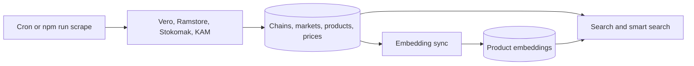

# Scraper And Search Pipeline

## Public Summary

How prices get from chain websites to search results: scrapers fill MongoDB, an embedding sync turns products into vectors, and search combines vector and keyword matches. This page is the overview; the module pages hold the details.

## Internal Details

| Stage | What happens | Details |
|-------|--------------|---------|
| Schedule | Monday and Thursday 03:00 Europe/Skopje, or `npm run scrape [key]` | [Scraper: Settings](./modules/scraper.md#settings) |
| Scrape | Registry creates one scraper per chain; each run fetches stores and pricelists | [Scraper: Registry and Contract](./modules/scraper.md#registry-and-contract) |
| Save | Products upserted by title (last price wins within a store), prices stamped with `lastSeenAt` | [Scraper: Saving Prices](./modules/scraper.md#saving-prices) |
| Clean up | Stale and unlisted-store prices removed behind half-size guards; unpriced scraper-made products and their embeddings deleted | [Scraper: Stale Price Cleanup](./modules/scraper.md#stale-price-cleanup) |
| Embed | After all chains, products whose title or category changed are embedded; skipped if the `ai-search` flag is off or no provider is configured | [Search](./modules/search.md) |
| Search | Hybrid vector + keyword search; smart search adds recipes and the weekly budget | [Search](./modules/search.md), [Public Holiday](./modules/public-holiday.md) |

Prices also change outside the pipeline: admins add hand-added prices ([Product: Price Ownership](./modules/product.md#price-ownership)), and chain or market deletes remove prices and orphaned products ([Chain](./modules/chain.md#cascade-delete)).

## Source Anchors

| Path | Relevance |
|------|-----------|
| `apps/server/src/modules/scraper/scraper.cron.js` | Schedule and post-scrape steps |
| `apps/server/src/modules/scraper/scraper.registry.js` | Scraper keys |
| `apps/server/src/modules/scraper/scraper.service.js` | Orchestrator |
| `apps/server/src/modules/search/product-embedding-sync.service.js` | Incremental embedding sync |
| `apps/server/src/modules/search/search.service.js` | Hybrid search |
| `apps/server/src/modules/search/smart-search.service.js` | Recipe and budget-aware search |

## Risks and Trade-offs

- Upstream site changes can break a scraper; the cleanup guards keep old prices rather than wiping a store.
- Embeddings lag the catalog until the next sync (after the next scrape, or `npm run embeddings:generate`).
- With the `ai-search` flag off, `GET /api/search` returns no results; without an embedding provider it has no vector side. See [Search](./modules/search.md).
