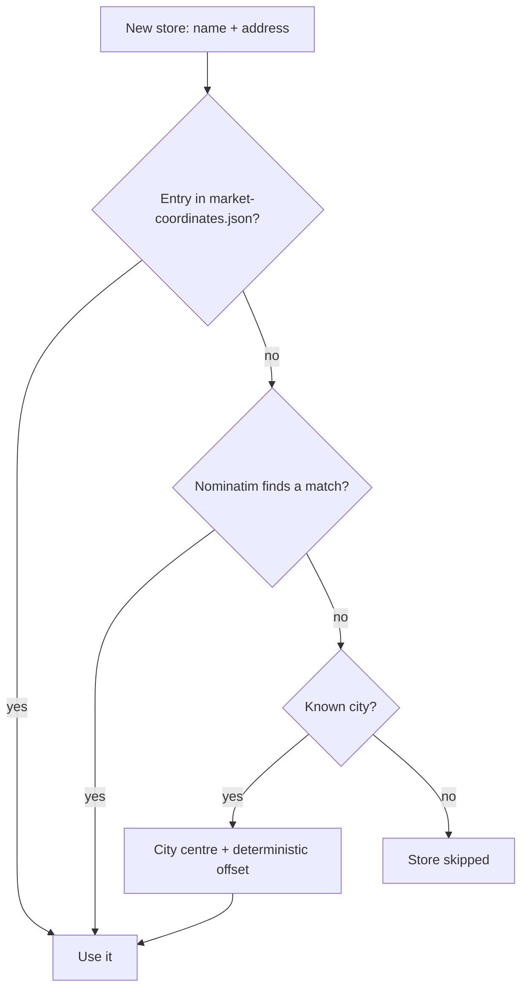

# Geolocation

## Public Summary

Every store Obrok scrapes needs a map coordinate, but the chains' websites don't reliably provide one. Turning a scraped store name like "КАМ Илинден" into a `[latitude, longitude]` pair is a three-tier lookup, and it fails in specific, findable ways. This page explains the lookup and walks through a real case where it had silently misplaced a large share of two chains' stores, and how that was found and corrected.

## Internal Details

### The Three-Tier Lookup

The lookup runs only the first time a store name is seen; existing stores keep their stored coordinate.

1. **Static file** (`data/market-coordinates.json`): hand-maintained coordinates keyed by the normalized store name. Checked first, so a verified coordinate always wins. `npm run coords:populate` fills missing entries (Google Geocoding when `GOOGLE_MAPS_API_KEY` is set, otherwise Nominatim), and `npm run coords:seed` pushes the file's coordinates onto stores already in MongoDB.
2. **Nominatim**: OpenStreetMap's public geocoder, limited to North Macedonia and throttled to one request per 1.1 s as its usage policy requires (one retry after 5 s on HTTP 429). Up to four queries are tried in order: the cleaned address with city, the store name with city, the address transliterated to Latin, and finally the city alone. That last query means a store with no better match usually lands on Nominatim's city point.
3. **City-centre fallback**: when every query fails or returns nothing and the address names one of 27 known cities, the store is placed 80 to 250 m from that city's centre, in a direction and distance derived from a hash of its name, so several fallbacks in one city don't stack on one pixel. A store with no usable coordinate at all is skipped, and its prices are never scraped.

The approximate tiers exist because a skipped store is worse than an approximate one. The trade-off is that an approximate coordinate looks plausible (it's in the right city) while being kilometres off, and nothing downstream marks it as low-confidence.

### A Case Study: Finding and Fixing Real Drift

An audit of two chains, KAM and Stokomak, showed this failure mode in practice.

**KAM.** KAM's store-list API already returns a precise `Coordinates` field per shop, but the scraper (`kam.scraper.js`) forwards only name, address and price-list URL. Comparing stored coordinates against that field showed 11 branches placed at or near a city centre: one Skopje branch on Џон Кенеди was off by over a kilometre, and several small-town branches by up to 15 km. The fix copied the API's coordinates into `market-coordinates.json` for every KAM store; the scraper still doesn't read the field, so a new KAM store goes through the normal lookup until it is added to the file.

**Stokomak.** Stokomak's site gives no address or coordinate, only a neighbourhood name in a dropdown ("СЕВЕР", "КАРПОШ 2"), which the scraper also uses as the address. With no ground truth from the source, each Skopje neighbourhood name was checked against OpenStreetMap's administrative boundaries: 10 branches were in the wrong neighbourhood, and one ("Козле") was 28.7 km outside Skopje, a wrong place altogether rather than a near miss.

**A second bug** surfaced alongside: "Чаир" and "Чаир 2" had identical stored coordinates, so one had been copied rather than geocoded. A business directory confirmed the first branch's address. No listing could be found for the second, so it was separated from the first with the same kind of deterministic offset the fallback uses: an honest approximation, not a verified fix.

### A Related, Unfixed Limitation

The audit found KAM's API listing three different branches all named plain "Велес" at three addresses. Scrapers deduplicate stores by name and keep the first, so the other two never enter the database. This is a data-modeling gap (the source doesn't guarantee unique names); fixing it means changing how a store is identified, not correcting a coordinate.

### Why This Matters Beyond the Pin

A store's coordinate feeds [meal search](/concepts/search-and-recipes), which ranks stores by distance, and the [map's routing](/concepts/routing-and-map), which uses it as the route's end. A wrong coordinate can rank a store as the "nearest complete match" when it isn't, or route a user to the wrong building.

## Source Anchors

| Path | Relevance |
|------|-----------|
| `apps/server/src/modules/scraper/geocoder.service.js` | Three-tier lookup, Nominatim throttle, city fallback |
| `apps/server/src/modules/scraper/scraper.service.js` | Geocodes only new stores; skips stores without a coordinate |
| `apps/server/src/data/market-coordinates.json` | Static tier |
| `apps/server/src/scripts/populate-coordinates.js` | Fills the static file (`npm run coords:populate`) |
| `apps/server/src/scripts/seed-coordinates.js` | Pushes the file into MongoDB (`npm run coords:seed`) |
| `apps/server/src/modules/scraper/markets/kam.scraper.js` | Ignores the API's `Coordinates` field |
| `apps/server/src/modules/scraper/markets/base.scraper.js` | Name-based deduplication (source of the Велес gap) |
| [Scraper Module reference](/backend/modules/scraper) | Full pipeline detail |
| [Market Module reference](/backend/modules/market) | Coordinate storage format |

## Risks and Trade-offs

- Bad coordinates are fixed by hand in the static file; nothing flags a store as approximate versus verified.
- Chain-provided coordinates (KAM's) were trusted as-is, without a second source.
- The name hash multiplies by 31 and adds each character in turn, so names that differ only in the last character (a trailing "1" vs "2") get offsets 1 degree and 1 m apart. Such stores can end up a few metres apart instead of clearly separated.
