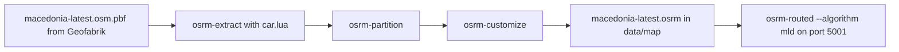
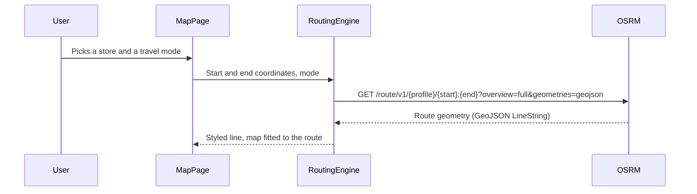

# Routing & Map

## Public Summary

The map shows every store as a pin, groups pins into clusters when there are too many to show, and draws a walking, cycling or driving route from the user to a chosen store. Routes come from OSRM, an open-source routing engine running in the project's own Docker stack, rather than a paid directions API.

## Internal Details

### Why Self-Hosted Routing

Commercial routing APIs (Google Directions, Mapbox Directions) charge per request and need an API key and an outside service for every route. OSRM runs inside the project's Docker Compose stack on one country's map data: no per-request cost, no key, and routing keeps working when the outside service the app does depend on (Gemini, for search) is down.

### How the Routing Data Is Prepared

OSRM routes over a preprocessed graph, built once, offline, by `init-route-data.sh`:

Nothing here runs per request; `osrm-routed` serves the finished graph.

### A Real Limitation: One Profile Serves Three Modes

The three travel modes each have their own line colour and dash pattern, and each requests a different profile in the URL (`foot`, `bicycle`, `car`). But OSRM's behaviour (which roads are usable, one-way rules, speeds) is fixed by the Lua profile used at `osrm-extract` time, not by that URL segment, and the preparation step only runs `car.lua`. So walking and cycling routes are computed on the same car graph as driving: they won't take a footpath a car couldn't use. The modes differ in the UI, not in the route.

### Request Flow

The browser calls OSRM directly, not through the API. The base URL comes from `VITE_OSRM_URL` (default `http://localhost:5001/route/v1`); in production Nginx proxies `/route/` to the OSRM container. Start and end go in OSRM's `longitude,latitude` order.

### Rendering Hundreds of Stores

The map uses MapLibre GL through `react-map-gl`. Store pins are DOM markers, so drawing hundreds at once would be slow; `use-supercluster` (Supercluster) groups the pins inside the visible bounds into clusters until zoom 15. Clicking a cluster zooms to the level where it splits. This is a performance measure only: a cluster's position is the average of its stores, not a real place.

## Source Anchors

| Path | Relevance |
|------|-----------|
| `init-route-data.sh` | OSRM data preparation (`car.lua` only) |
| `docker-compose.dev.yml`, `docker-compose.prod.yml` | OSRM service (`osrm-routed --algorithm mld --port 5001`) |
| `apps/nginx/nginx.conf` | `/route/` proxy to OSRM in production |
| `apps/client/src/api/consts.js` | `OSRM_URL` |
| `apps/client/src/features/map/components/RoutingEngine.jsx` | Route request, per-mode styling, fit to bounds |
| `apps/client/src/features/map/components/MarketMarkers.jsx` | Clustering settings |
| [Map Feature reference](/frontend/features/map) | Component breakdown |
| [Map And UX Flows](/frontend/map-flows) | Interaction flows |

## Risks and Trade-offs

- Walking and cycling routes don't follow mode-specific road rules (see above); the UI promises more than the routing backend delivers.
- Routes are only as current as the last OSM extract; road changes need a manual re-run of `init-route-data.sh`.
- Route quality depends on OSM's road graph, and the end point on Obrok's own [geocoding](/concepts/geolocation).
