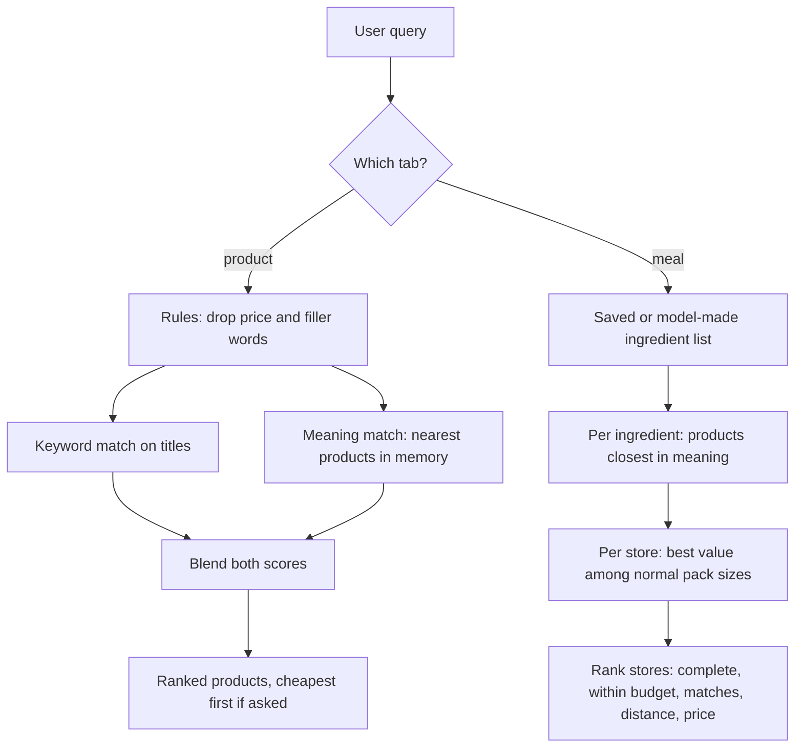

# Search & Recipe Decomposition

## Public Summary

Obrok answers two kinds of questions: "where is milk cheapest" (product search) and "I want to cook tavče gravče this week, where should I shop" (meal search). Product search reads the query with simple rules and never calls a language model. Meal search asks a small language model to split the meal into ingredients once per dish, then prices every ingredient at every store. This page explains why it works that way; exact weights, thresholds and endpoints are in the [Search Module reference](/backend/modules/search).

## Internal Details

### Why Two Matching Methods

Keyword search alone fails on synonyms and on Macedonian written in either Cyrillic or Latin script. Meaning-based (vector) search fixes that but is weaker at "the title literally says this". Obrok runs both and blends them, giving the keyword signal more weight.

**Embeddings** are lists of numbers that place texts with similar meaning close together. Each product's title and category is embedded once, and again only when that text changes. A query is embedded at search time and compared with every product in an in-memory index. Scoring the whole catalogue matters: "паста" finds ФУСИЛИ even though the title shares no word with the query.

### Why No Language Model for Product Search

Price intent ("најевтино", "najskapo") and filler ("каде", "има ли") are a small, fixed vocabulary, so plain rules handle them instantly and for free. A model call would add latency and cost to every search for no better result.

### Cheapest First, Without Nonsense

When a query asks for the cheapest or most expensive, only the results that clearly are the product get sorted by price; weaker matches follow. Otherwise "cheapest milk" would open with a chocolate bar that mentions milk. Variants and accessories are kept out of the price order the same way: chocolate milk and coffee creamer for milk, egg dye ("БОЈА ЗА ЈАЈЦА") for eggs, unless the query asks for that variant.

### Meal Decomposition

The ingredient list comes from the language model; there is no recipe database. That works for any dish without anyone curating recipes, at the cost of depending on the model's judgment for each dish and phrasing. Each answer is saved, so a dish is decomposed once and later searches (in either script) reuse it.

Each ingredient is then matched by meaning, not by word: "паста" in a meal should be priced with pasta, not "ПАСТА ЗА ЗАБИ" (toothpaste), even though that title contains the word. Only products very close to the best match count, and within a store only its closest matches compete on price, so a cheaper near-miss can't win.

**Pack sizes** keep the comparison fair. Prices are compared per kilogram or litre, but only among packs of a normal size for that ingredient (read from the title). Milk is priced with a carton rather than coffee-creamer portions, and cheese with a usual pack rather than a 1 kg block. Where titles carry no size, as with eggs, the cheapest package is used. The basket always adds what you actually pay for the package.

### The Budget Angle

Every meal search is scored against the statutory daily meal allowance in North Macedonia (140 MKD per working day, Monday to Saturday, minus public holidays), which is where the app's name comes from. A store is "within budget" if the whole ingredient list fits that week's total.

### Distance

Stores are ranked by completeness, then budget fit, then how many ingredients they carry; straight-line distance from the user decides between stores that tie on those, and price after that. This is where [geolocation](/concepts/geolocation) accuracy affects search quality: a store with wrong coordinates can be ranked as nearer or farther than it really is. Stores of one chain usually share a pricelist, so only a few per chain are shown.

## Source Anchors

| Path | Relevance |
|------|-----------|
| `apps/server/src/modules/search/search.service.js` | Product search |
| `apps/server/src/modules/search/query-rules.js` | Price and filler words, variants |
| `apps/server/src/modules/search/smart-search.service.js` | Meal search, pack sizes, store ranking |
| `apps/server/src/modules/search/intent-parser.service.js` | Meal decomposition |
| `apps/server/src/shared/utils/obrokBudget.js` | Weekly budget |
| [Search Module reference](/backend/modules/search) | Constants, endpoints, failure behavior |

## Risks and Trade-offs

- Meal search needs the language model for any dish it hasn't seen; if decomposition fails, the user is asked to rephrase or use product search. Product search still works without the vector index, on keywords alone.
- There is no way to check that an ingredient list is "correct" the way a curated recipe database could.
- The blend weights and cut-offs are tuned against a small hand-written test set (`npm run eval:search`), not a large labeled dataset.
- Variant rules are a hand-kept list; only milk flavours are covered so far.
