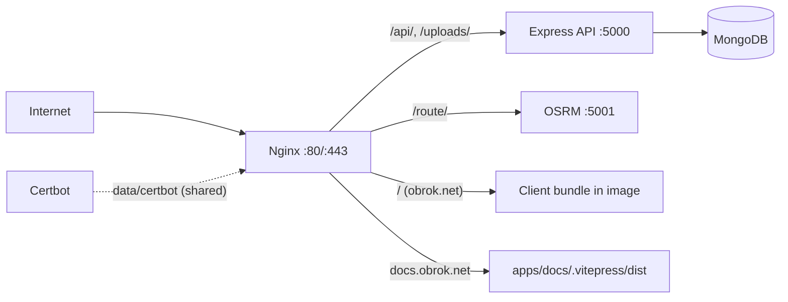

# Production Environment

## Public Summary

Production is `docker-compose.prod.yml` on one VPS. Nginx is the only public entrypoint (ports 80 and 443): it serves the React bundle and the docs site, and proxies the API and OSRM. Certbot keeps one Let's Encrypt certificate for `obrok.net` and `docs.obrok.net` renewed. Publishing a GitHub release runs the tests and redeploys over SSH.

## Internal Details

### Runtime Topology

### Services

| Service | Image or build | Restart | Notes |
| --- | --- | --- | --- |
| `nginx` (`obrok_nginx`) | `apps/client/Dockerfile.prod`: builds the Vite bundle, then copies it into `nginx:alpine` | `unless-stopped` | Mounts `apps/nginx/nginx.conf`, `data/certbot/conf`, `data/certbot/www`, and the docs build read-only at `/var/www/docs`. Runs `nginx -s reload` every 12 hours to pick up renewed certificates |
| `certbot` (`obrok_certbot`) | `certbot/certbot` | `unless-stopped` | Runs `certbot renew` every 12 hours |
| `api` (`obrok_api`) | `apps/server/Dockerfile.prod`: `npm ci --omit=dev`, Alpine Chromium for Puppeteer, runs as `node` | `always` | `init: true` forwards SIGTERM to Node so graceful shutdown runs (crons stop, server closes, Mongo disconnects; forced exit after 8 s) |
| `osrm` (`obrok_osrm`) | `osrm/osrm-backend` | `unless-stopped` | `osrm-routed --algorithm mld --port 5001 /data/macedonia-latest.osrm`, data from `data/map` |
| `db` (`obrok_db`) | `mongo:8.0` | `always` | Published only on `127.0.0.1:6969`; healthcheck gates API start |

Persistent data:

| Data | Where |
| --- | --- |
| MongoDB | Named volume `obrok_db` |
| Generated CSV reports | Named volume `obrok_reports` at `/app/src/data/reports` |
| Uploaded images | Bind mount `apps/server/src/uploads` |
| Certificates and ACME webroot | `data/certbot/conf`, `data/certbot/www` |
| OSRM data | `data/map` |

### API Crash Behavior

The API process exits instead of staying up in a broken state, and `restart: always` brings it back:

- A failed startup (database connection, seeding, startup cleanup) logs `Startup failed:` and exits with code 1.
- An unhandled promise rejection crashes the process (Node's default; `server.js` registers no `unhandledRejection` handler).

### Nginx Routes

`obrok.net` (HTTPS, HTTP/2, HSTS):

| Location | Behavior |
| --- | --- |
| `/` | Client bundle with SPA fallback to `index.html`, `expires -1` so a new deploy is picked up |
| `/assets/` | Hashed bundles, `expires 1y`, `404` when missing (no fallback, so a stale page does not get HTML for its JS) |
| `/api/`, `/uploads/` | Proxied to `obrok_api:5000` |
| `/route/` | Proxied to `obrok_osrm:5001`. Only the OSRM `route` service is reachable (`VITE_OSRM_URL=https://obrok.net/route/v1`) |

Port 80 serves `/.well-known/acme-challenge/` from `/var/www/certbot` and redirects everything else to HTTPS. `client_max_body_size` is `12m` (uploads are capped at 10 MB by multer). The `docs.obrok.net` block is described in [docs.obrok.net Hosting](/deployment/docs-obrok-net).

Nginx resolves `obrok_api` and `obrok_osrm` when it starts, so it fails to start if either container is missing.

### First-Time VPS Setup

From the repository checkout on the VPS:

1. Create the root `.env` and `apps/client/.env` (see [ENV_TEMPLATES.md](https://github.com/martintrifunov/obrok/blob/main/ENV_TEMPLATES.md)). `CLIENT_ORIGIN` must be `https://obrok.net` or browsers get `403`.
2. `./init-route-data.sh` to build OSRM data in `data/map`.
3. `CERTBOT_EMAIL=you@example.com ./init-ssl.sh`

`init-ssl.sh` does the following:

1. Refuses to run without a real `CERTBOT_EMAIL` or without `data/map/*.osrm*` files.
2. If `data/certbot/conf` exists, asks for confirmation and moves it to `data/certbot/conf.bak-<timestamp>`. On any later error it restores the backup and restarts Nginx.
3. Downloads Certbot's `options-ssl-nginx.conf` and `ssl-dhparams.pem` into `data/certbot/conf` (the current `nginx.conf` sets protocols and ciphers itself and does not include them).
4. Creates a one-day self-signed certificate under `live/obrok.net` and starts Nginx (`up --build --force-recreate -d nginx`, which also starts `api`, `osrm` and `db`).
5. Deletes the dummy certificate and requests a real one with `certbot certonly --webroot` for both domains under the certificate name `obrok.net`.
6. Reloads Nginx, deletes the backup, and runs `docker compose -f docker-compose.prod.yml up -d`.

After that, `certbot` renews and `nginx` reloads on their 12-hour loops; no cron is needed.

### Release Pipeline

`.github/workflows/deploy.yml` runs when a GitHub release is published. Tags follow calendar versioning, for example `v2026.03.13.1`.

1. **test** (Node 24): in `apps/server`, `npm ci`, `npm run lint`, `npm run typecheck`, `npm test`; in `apps/client`, `npm ci`, `npm run lint`, `npm test`.
2. **deploy** (after test): SSH to the VPS with `appleboy/ssh-action` using secrets `VPS_HOST`, `VPS_USERNAME`, `VPS_SSH_KEY`, `VPS_PASSPHRASE`. The checkout path is the `VPS_APP_DIR` repository variable, defaulting to `/home/maco/projects/obrok`. On the VPS it:
   1. Loads `nvm` (the docs build runs with the host's Node).
   2. `git fetch --tags --force` and `git checkout -f <tag>`.
   3. Replaces `VITE_RELEASE_VERSION` in `apps/client/.env` with the tag.
   4. Builds the docs: `npm ci`, removes `.vitepress/cache`, `npm run docs:build`.
   5. `docker compose -f docker-compose.prod.yml up --build -d`.
   6. `docker restart obrok_nginx` so Nginx serves the new docs build.
   7. `docker image prune -f`.

## Source Anchors

| Path | Relevance |
| --- | --- |
| `docker-compose.prod.yml` | Services, restart policies, volumes |
| `apps/nginx/nginx.conf` | Routes, TLS, headers |
| `apps/client/Dockerfile.prod` | Nginx image with the client bundle |
| `apps/server/Dockerfile.prod` | Production API image |
| `apps/server/src/server.js` | Startup, exit on failure, graceful shutdown |
| `init-ssl.sh` | Certificate bootstrap |
| `init-route-data.sh` | OSRM data preparation |
| `.github/workflows/deploy.yml` | Release pipeline |

## Risks and Trade-offs

- Everything runs on one host, so a host incident takes down the app, database, routing and docs together.
- Images are built on the VPS during deploy. A failed build after `git checkout` leaves the checkout on the new tag while the old containers keep running.
- The client's `VITE_*` values are baked in at image build time; changing `apps/client/.env` needs `up --build`.
- Nginx and Certbot use `unless-stopped`: a container stopped by hand stays stopped after a reboot.
