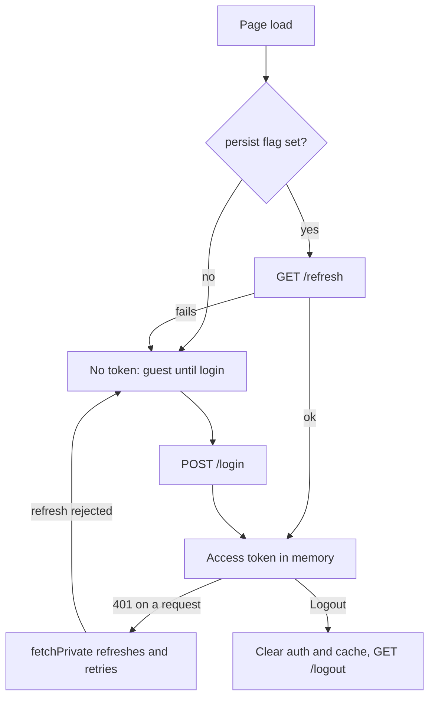

# Auth Feature

## Public Summary

Admins log in with username and password. The access token is kept only in memory; the refresh token is an httpOnly cookie set by the server. "Trust this device" lets the app restore the session silently after a reload. Route guards are described in [Routing And Access Control](../routing-auth).

## Internal Details

### Files

| File | Role |
|------|------|
| `pages/Login.jsx` | Login form and "Trust this device" checkbox |
| `components/PersistLogin.jsx` | Silent refresh on load when the device is trusted |
| `components/RequireAuth.jsx` | Redirects to `/login` without a token |
| `hooks/useAuth.js` | Selects `auth`, `setAuth`, `persist`, `setPersist` from `authStore` |
| `hooks/useRefreshToken.js` | `GET /refresh`, stores the new access token |
| `hooks/useLogout.js` | Clears session and query cache, calls `GET /logout` |

### Session Lifecycle

| Step | Behavior |
|------|----------|
| Login | `POST /login` with `{ username, password }`. On success: `queryClient.clear()`, store `{ username, accessToken }`, navigate to `state.from` or `/dashboard`. |
| Login errors | No response: "No Server Response". 400: "Missing Username or Password". 401: "Unauthorized". Anything else (including the 429 login rate limit): "Login Failed". |
| Trust this device | Toggles `persist`, the only auth field saved to `localStorage` (`maco-auth`). Without it, a reload drops the session. |
| Restore | `PersistLogin` calls `GET /refresh` once on mount when `persist` is on and no token is held. |
| Logout | `authStore.logout()` clears `auth` and `persist`, `queryClient.clear()` drops cached admin data, then `GET /logout` (errors are only logged). Callers navigate to `/login`. |

Logout is available from the dashboard header and the map settings menu.

## Source Anchors

| Path | Relevance |
|------|-----------|
| `apps/client/src/features/auth/` | Login page, guards, auth hooks |
| `apps/client/src/store/authStore.js` | Auth state; only `persist` is persisted |
| `apps/client/src/api/fetch.js` | Refresh on 401 and shared refresh promise |
| `apps/server/src/modules/auth/auth.routes.js` | `POST /login`, `GET /refresh`, `GET /logout` |

## Risks and Trade-offs

- Keeping the access token in memory limits exposure to XSS, at the cost of a refresh call on every reload for trusted devices and a full re-login for untrusted ones.
- The client stores no role, so it cannot hide admin-only features from non-admin users.
- Login error text is chosen by status code, so the server's own messages (such as the rate-limit message) are not shown.
