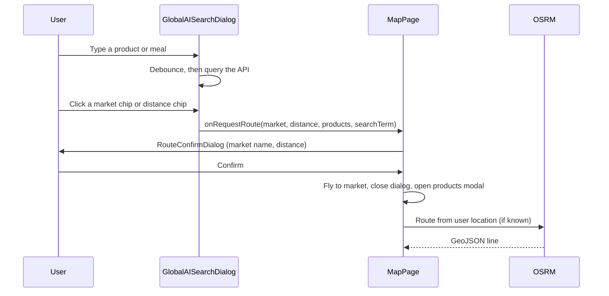

# Map And UX Flows

## Public Summary

This page follows the main map journeys end to end: locating the user, getting directions from a market pin, and getting directions from an AI search result. Component inventory, chain filters and configuration are on the [Map Feature](./features/map) page.

## Internal Details

### Startup

1. The map opens on central Skopje (zoom 16) with the OpenFreeMap "liberty" style. On load it adds a 3D buildings layer and tilts to 45 degrees.
2. `LocateUser` starts watching the position. A full-screen loader is shown, and the settings menu and AI button are hidden, until the first fix or a 10 second deadline.
3. Markets load from `GET /markets?limit=0` and are drawn as clustered pins, filtered by the visible chains.

If location is denied, unavailable or times out, routing stays disabled; browsing and search still work.

### Directions From A Market Pin

1. Clicking a pin opens a popup with the market name, chain logo, a "Products" button, a directions button and the last scrape time.
2. The directions button sets the route start to the user's location and the end to the pin. It does nothing if the user has not been located, and it is disabled while a route is active.
3. `RoutingEngine` requests the route from OSRM and fits the map to it. Route controls appear: mode buttons (walking, car, cycling) and a cancel button that clears the route and resets the mode to walking.

### Directions From AI Search

On confirm, `MapPage`:

- sets the route only if the user's location is known, but always flies to the market (zoom 17);
- opens `SharedMarketProductsModal` for that market, pre-filled with the product title (product search) or showing the meal's shopping list (meal search);
- remembers this as the active smart-route context, so the same market's popup "Products" button opens with the same search until the route is cancelled.

The two search tabs and their API calls are described on the [Map Feature](./features/map#ai-search-dialog) page.

## Source Anchors

| Path | Relevance |
|------|-----------|
| `apps/client/src/features/map/pages/MapPage.jsx` | Route state, confirm handling, map setup |
| `apps/client/src/features/map/components/LocateUser.jsx` | Geolocation watch and loading state |
| `apps/client/src/features/map/components/MarketMarkers.jsx` | Pins, clusters, popup, directions button |
| `apps/client/src/features/map/components/RoutingEngine.jsx` | OSRM request and route layer |
| `apps/client/src/features/map/components/RouteControls.jsx` | Mode buttons and cancel |
| `apps/client/src/features/map/components/RouteConfirmDialog.jsx` | Confirm step for AI search routes |
| `apps/client/src/features/map/components/GlobalAISearchDialog.jsx` | Search dialog and route requests |
| `apps/client/src/components/ui/SharedMarketProductsModal.jsx` | Per-market products modal |

## Risks and Trade-offs

- Pin directions skip the confirm dialog while AI search routes use it, so the two entry points behave differently.
- Confirming an AI route without a location still flies to the market and opens the modal but draws no route, with no message explaining why.
- `MapPage` owns route, dialog and smart-route state together; new flows add more cross-component state there.
