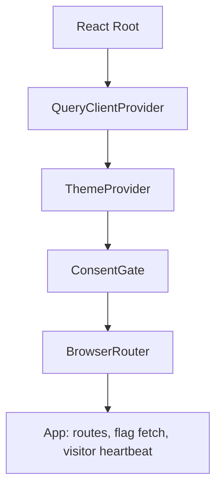

# Frontend Overview

## Public Summary

The client (`apps/client`) is a React 19 + Vite single-page app. The public map at `/` is the main product; `/dashboard/*` is an admin area behind login. Server data goes through TanStack Query, client-only state lives in three small Zustand stores, and the UI is Material UI with MapLibre for the map.

## Internal Details

### Provider Composition

`ConsentGate` renders only the terms-of-service dialog (`TermsAndPrivacyModal`) until the visitor accepts it. The dialog cannot be dismissed with Escape. Acceptance is stored as `obrok_terms_accepted = "true"` in `localStorage`; if storage is blocked it lasts for the current page load. Because the router and `App` sit inside the gate, nothing below it runs before acceptance: no feature-flag fetch, no visitor heartbeat, no map.

On mount, `App` fetches public feature flags once and starts the visitor heartbeat (see [Insights, Reports & Flags](./features/insights-reports-flags)).

### Where Things Live

| Folder | Contents |
|--------|----------|
| `src/api/` | `fetchPublic` / `fetchPrivate`, `queryClient`, visitor id, env constants |
| `src/features/<domain>/` | Pages, components and query hooks per domain: auth, chains, markets, products, public-holidays, images, dashboard, map, insights, reports, feature-flags |
| `src/store/` | Zustand stores: auth, theme, feature flags |
| `src/hooks/` | Shared hooks: `useDebounce`, `useFeatureFlag`, `useInitFromData`, `useResettablePage` |
| `src/components/` | App shell (`App`, `ConsentGate`, `Layout`, `NotFound`) and shared UI (`SharedMarketProductsModal`, `FileUploader`, `RichTextEditor`, `GlobalLoadingProgress`, `TermsAndPrivacyModal`) |
| `src/theme/` | MUI theme and `ThemeProvider` (light/dark from `themeStore`) |

### Environment Variables

| Variable | Default | Used for |
|----------|---------|----------|
| `VITE_API_URL` | `http://localhost:5000` | API base; requests go to `${VITE_API_URL}/api`, images load from `${VITE_API_URL}/uploads/...` |
| `VITE_OSRM_URL` | `http://localhost:5001/route/v1` | OSRM route service, called directly by the browser |
| `VITE_DEFAULT_VISIBLE_CHAINS` | unset (falls back to `Vero,Ramstore`) | Chains shown on the map before the visitor picks a filter |
| `VITE_RELEASE_VERSION` | `Dev Build` | Release label on the full-screen loading indicator |

### Page Map

| Page | Job |
|------|-----|
| [Routing And Access Control](./routing-auth) | Route tree and guard order |
| [State And Server Data](./state-data) | Stores, query conventions, fetch wrappers, error contract, browser storage keys |
| [Map And UX Flows](./map-flows) | End-to-end map journeys (directions, AI search) |
| [Features](./features/auth) | One page per feature area with files and behavior |

### Tests

`npm test` in `apps/client` runs Vitest with jsdom and Testing Library. Specs sit next to the code (`*.test.js[x]`); `src/test/renderWithProviders.jsx` wraps components in the app providers.

## Source Anchors

| Path | Relevance |
|------|-----------|
| `apps/client/src/entry.jsx` | Provider composition chain |
| `apps/client/src/components/layout/ConsentGate.jsx` | Terms acceptance gate |
| `apps/client/src/components/ui/TermsAndPrivacyModal.jsx` | Terms and privacy dialog |
| `apps/client/src/components/layout/App.jsx` | Route tree, flag fetch, heartbeat |
| `apps/client/src/api/consts.js` | Environment variables and defaults |
| `apps/client/src/features/` | Feature modules |
| `apps/client/src/store/` | Zustand stores |
| `apps/client/src/hooks/` | Shared hooks |
| `apps/client/src/test/renderWithProviders.jsx` | Test render helper |

## Risks and Trade-offs

- `VITE_*` values are baked in at build time; changing them needs a rebuild of the client image.
- The consent gate blocks the whole app, including analytics. That is intended, but it also means a broken terms dialog takes down the site.
