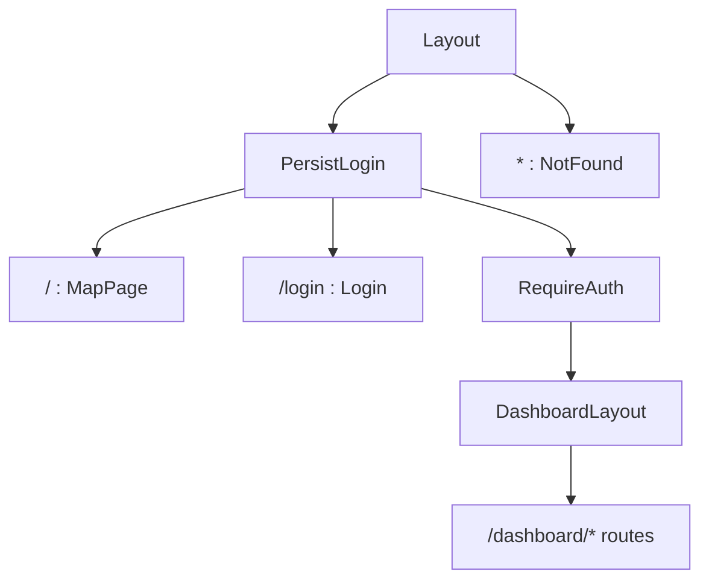

# Routing And Access Control

## Public Summary

All routes are declared in one file. The map and login page are public; every `/dashboard` route requires an access token in memory. This page covers the route tree and guard order. Login, token refresh and logout are on the [Auth Feature](./features/auth) page.

## Internal Details

### Route Tree

| Path | Element | Guarded |
|------|---------|---------|
| `/` | `MapPage` | No |
| `/login` | `Login` | No |
| `/dashboard` | `Dashboard` (redirects to `/dashboard/chains`) | Yes |
| `/dashboard/{chains,markets,products,holidays,reporting,insights,features}` | Section pages | Yes |
| `/dashboard/{chain,market,product,holiday}` | Add form | Yes |
| `/dashboard/{chain,market,product,holiday}/:id` | Edit form | Yes |
| `*` | `NotFound` | No |

Section pages and forms are listed on the [Dashboard Feature](./features/dashboard) page.

### Guard Order

1. `PersistLogin` wraps the map, login and dashboard. If "Trust this device" is on and there is no access token, it calls `GET /refresh` once on mount and shows `GlobalLoadingProgress` until that settles. A failed refresh is swallowed.
2. `RequireAuth` redirects guests to `/login` with `state.from`, so the login page can send them back, and sends logged-in users who aren't admins to the map. The role is read from the access token (`roleFromToken`, exposed as `useAuth().isAdmin`); the server still checks it on every admin request.

### Mid-Session Expiry

`fetchPrivate` refreshes the token on a 401 and retries once (details in [State And Server Data](./state-data#fetch-wrappers)). If the refresh is rejected with 401 or 403, auth is cleared, `RequireAuth` re-renders and redirects to `/login`. The list pages also redirect to `/login` themselves when a query fails with 401.

## Source Anchors

| Path | Relevance |
|------|-----------|
| `apps/client/src/components/layout/App.jsx` | Route definitions |
| `apps/client/src/components/layout/Layout.jsx` | Root outlet |
| `apps/client/src/components/layout/NotFound.jsx` | Catch-all page |
| `apps/client/src/features/auth/components/PersistLogin.jsx` | Silent refresh on load |
| `apps/client/src/features/auth/components/RequireAuth.jsx` | Token check and redirect |
| `apps/client/src/api/fetch.js` | 401 refresh and retry |

## Risks and Trade-offs

- `PersistLogin` wraps the public map too, so a trusted device waits for the refresh call before the map renders.
- The client reads the role from the token without verifying it. That only decides what is shown; a forged token still fails on the server.
